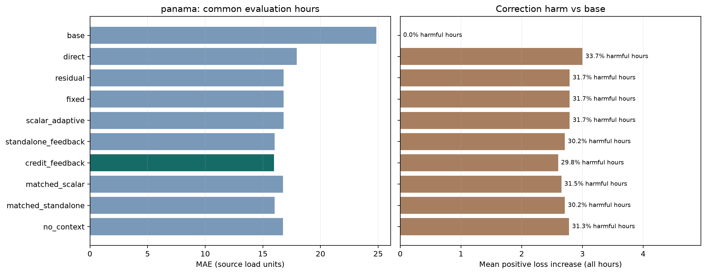
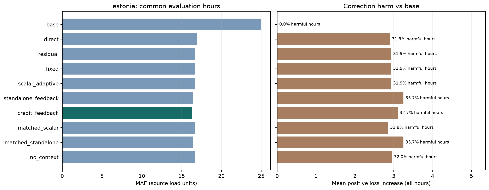

# Realised-credit-based adaptive residual correction

Research question: does realised-credit-based component weighting improve residual correction over fixed scaling and simpler adaptation? The mechanism question compares interaction-aware credit with standalone component benefit.

This is a retrospective reanalysis of previously inspected Panama 2020 and Estonia 2024 periods. Cleanup and new comparisons do not create a new blind test. All choices are frozen using Panama 2018–2019 before final-year models are fitted; Estonia receives the same configuration and policy choices without local tuning.

## Method and comparisons

Base GBR → OOF-trained HistGBR correction → grouped TreeSHAP contributions → past realised credit → bounded component weights → forecast → feedback after the actual value arrives. See the [method and protocol in README](../README.md#metoodika) and the matched ablations below; detailed equations belong to the thesis document.

| Method | Role |
| --- | --- |
| base | B0 Base GBR |
| direct | B1 Direct HistGBR |
| residual | B2 Standard residual correction |
| fixed | B3 Fixed-weight correction |
| scalar_adaptive | B4 Scalar least-squares adaptation (no XAI) |
| standalone_feedback | B5 Standalone component feedback |
| credit_feedback | B6 Proposed interaction-aware credit feedback |
| matched_scalar | A1 One credit weight, matched settings |
| matched_standalone | A2 No interaction credit, matched settings |
| no_context | A3 No hour conditioning, matched settings |

The direct HistGBR predicts load using the same OOF training rows, features and parameters as the residual HistGBR. Only the target (load vs residual) and additive base anchor differ. B2–B6 and all ablations share one fitted base/residual model per fold.

## Frozen development choices

| Family | Candidate | Setting | Development ratio |
| --- | --- | --- | --- |
| fixed | identity | None | 1.0000 |
| scalar_adaptive | identity | None | 1.0000 |
| standalone_feedback | standalone_feedback_w672_h1_s1.0 | {'window_hours': 672, 'by_hour': True, 'strength': 1.0} | 0.9913 |
| credit_feedback | credit_feedback_w672_h1_s1.0 | {'window_hours': 672, 'by_hour': True, 'strength': 1.0} | 0.9900 |

Identity means development selected the unchanged full correction. Identical predictions are reported as a selection outcome, not independent evidence. The three matched ablations use B6's settings without re-tuning.

## Credit, memory and parameter robustness

The same study also evaluates MAE-credit, recency-weighted memory and window/strength sensitivity, using the SAME fitted models, components and timestamps. MAE-credit changes only squared to absolute realised game loss. Memory aging weights past credits by `2 ** (-age_hours / half_life_hours)` inside the same finite window; the numerator and denominator use the same decay. Cold start and hour conditioning remain matched to B6.

Development compared half-lives [24, 168, 672] hours and uniform fallback, using B6's MAE-ratio objective/scope guard; uniform wins ties. Frozen memory: **exponential**, half-life **672** hours. Estonia receives the same selection without local tuning.

Every combination of windows [168, 336, 672] hours and strengths [0.25, 0.5, 1.0] is reported with squared credit, uniform memory and B6 hour context. No sensitivity winner is selected on the final periods. A row matching B6 is a duplicate control. If B6 is identity, matched loss/memory ablations remain identities; active sensitivity rows then use predeclared same-hour context.

All primary and robustness choices are frozen together before final-year models are fitted. The added robustness rows are descriptive; paired bootstrap intervals retain the original nine baseline/ablation comparisons and their multiplicity correction.

## panama: 2020-01-01 00:00:00 to 2020-06-27 00:00:00

Scored 4273 of 8784 calendar hours; unscored: 4511. Every method uses these same timestamps. Hours beyond the end of the source series are also unscored; missing values are never interpolated.

| method | n | MAE | RMSE | improvement_vs_base_pct | improvement_vs_residual_pct |
| --- | --- | --- | --- | --- | --- |
| base | 4273 | 24.8427 | 31.9119 | 0.0000 | -47.8027 |
| direct | 4273 | 17.9412 | 23.7039 | 27.7806 | -6.7423 |
| residual | 4273 | 16.8080 | 22.2125 | 32.3422 | 0.0000 |
| fixed | 4273 | 16.8080 | 22.2125 | 32.3422 | 0.0000 |
| scalar_adaptive | 4273 | 16.8080 | 22.2125 | 32.3422 | 0.0000 |
| standalone_feedback | 4273 | 16.0323 | 21.4459 | 35.4645 | 4.6148 |
| credit_feedback | 4273 | 15.9638 | 21.3537 | 35.7403 | 5.0224 |
| matched_scalar | 4273 | 16.7394 | 22.1309 | 32.6182 | 0.4080 |
| matched_standalone | 4273 | 16.0323 | 21.4459 | 35.4645 | 4.6148 |
| no_context | 4273 | 16.7628 | 22.1719 | 32.5241 | 0.2688 |

| method | harmful_rate_vs_base | harmful_magnitude_vs_base | harmful_rate_vs_residual | harmful_magnitude_vs_residual |
| --- | --- | --- | --- | --- |
| base | 0.0000 | 0.0000 | 0.6831 | 10.8252 |
| direct | 0.3370 | 3.0006 | 0.5481 | 3.0775 |
| residual | 0.3169 | 2.7905 | 0.0000 | 0.0000 |
| fixed | 0.3169 | 2.7905 | 0.0000 | 0.0000 |
| scalar_adaptive | 0.3169 | 2.7905 | 0.0000 | 0.0000 |
| standalone_feedback | 0.3017 | 2.7117 | 0.4161 | 1.0634 |
| credit_feedback | 0.2979 | 2.5991 | 0.4095 | 0.9075 |
| matched_scalar | 0.3150 | 2.6535 | 0.0309 | 0.0931 |
| matched_standalone | 0.3017 | 2.7117 | 0.4161 | 1.0634 |
| no_context | 0.3134 | 2.7811 | 0.3590 | 0.1465 |

Proposed MAE improvement vs standard residual correction: 5.022%. Harmful-correction rates are fractions; harm magnitude is the mean positive increase in absolute error over ALL scored hours. Lower MAE does not imply fewer or less severe harmful corrections.

| method | scope | n | MAE | RMSE |
| --- | --- | --- | --- | --- |
| residual | overall | 4273 | 16.8080 | 22.2125 |
| residual | rapid_increase | 72 | 26.8296 | 36.1381 |
| residual | rapid_decrease | 137 | 29.2346 | 36.5927 |
| standalone_feedback | overall | 4273 | 16.0323 | 21.4459 |
| standalone_feedback | rapid_increase | 72 | 27.2131 | 36.5031 |
| standalone_feedback | rapid_decrease | 137 | 28.7562 | 36.2465 |
| credit_feedback | overall | 4273 | 15.9638 | 21.3537 |
| credit_feedback | rapid_increase | 72 | 27.4179 | 36.5448 |
| credit_feedback | rapid_decrease | 137 | 28.7178 | 36.1871 |
| matched_standalone | overall | 4273 | 16.0323 | 21.4459 |
| matched_standalone | rapid_increase | 72 | 27.2131 | 36.5031 |
| matched_standalone | rapid_decrease | 137 | 28.7562 | 36.2465 |
| no_context | overall | 4273 | 16.7628 | 22.1719 |
| no_context | rapid_increase | 72 | 26.9105 | 36.2473 |
| no_context | rapid_decrease | 137 | 29.2846 | 36.6933 |

| B | scope | difference | adjusted_low | adjusted_high |
| --- | --- | --- | --- | --- |
| base | overall | -8.8788 | -10.6738 | -7.3400 |
| base | rapid_increase | -14.9269 | -25.5947 | -4.5014 |
| base | rapid_decrease | -5.8405 | -10.0697 | -1.2358 |
| direct | overall | -1.9774 | -3.1210 | -1.0176 |
| direct | rapid_increase | -1.3909 | -4.6426 | 1.0216 |
| direct | rapid_decrease | -0.6023 | -2.4185 | 0.8929 |
| residual | overall | -0.8442 | -1.3845 | -0.3779 |
| residual | rapid_increase | 0.5883 | -0.5579 | 2.1348 |
| residual | rapid_decrease | -0.5168 | -1.4568 | 0.6258 |
| fixed | overall | -0.8442 | -1.3845 | -0.3779 |
| fixed | rapid_increase | 0.5883 | -0.5579 | 2.1348 |
| fixed | rapid_decrease | -0.5168 | -1.4568 | 0.6258 |
| scalar_adaptive | overall | -0.8442 | -1.3845 | -0.3779 |
| scalar_adaptive | rapid_increase | 0.5883 | -0.5579 | 2.1348 |
| scalar_adaptive | rapid_decrease | -0.5168 | -1.4568 | 0.6258 |
| standalone_feedback | overall | -0.0685 | -0.1211 | -0.0199 |
| standalone_feedback | rapid_increase | 0.2048 | -0.4068 | 1.3203 |
| standalone_feedback | rapid_decrease | -0.0384 | -0.3345 | 0.1983 |
| matched_scalar | overall | -0.7756 | -1.3033 | -0.3279 |
| matched_scalar | rapid_increase | 0.1747 | -0.6762 | 0.9177 |
| matched_scalar | rapid_decrease | -0.6788 | -1.5097 | 0.1242 |
| matched_standalone | overall | -0.0685 | -0.1211 | -0.0199 |
| matched_standalone | rapid_increase | 0.2048 | -0.4068 | 1.3203 |
| matched_standalone | rapid_decrease | -0.0384 | -0.3345 | 0.1983 |
| no_context | overall | -0.7990 | -1.2940 | -0.3761 |
| no_context | rapid_increase | 0.5074 | -0.6472 | 2.0571 |
| no_context | rapid_decrease | -0.5668 | -1.4916 | 0.5307 |

Differences are proposed minus reference MAE; negative favors proposed. Circular paired clock-hour block bootstrap uses masked unscored hours. Bonferroni covers all declared method/scope comparisons within a dataset at each block length; the second block length is a sensitivity analysis. It does not correct historical research choices or prove practical importance.

### Credit definition and memory aging

| method | n | MAE | RMSE | improvement_vs_residual_pct | harmful_rate_vs_base | harmful_magnitude_vs_base |
| --- | --- | --- | --- | --- | --- | --- |
| base | 4273 | 24.8427 | 31.9119 | -47.8027 | 0.0000 | 0.0000 |
| residual | 4273 | 16.8080 | 22.2125 | 0.0000 | 0.3169 | 2.7905 |
| credit_feedback | 4273 | 15.9638 | 21.3537 | 5.0224 | 0.2979 | 2.5991 |
| mae_credit | 4273 | 16.0065 | 21.4133 | 4.7688 | 0.2991 | 2.6159 |
| recency_credit | 4273 | 15.9393 | 21.3260 | 5.1684 | 0.2979 | 2.6042 |

### Window and feedback-strength sensitivity

| method | n | MAE | RMSE | improvement_vs_residual_pct | harmful_rate_vs_base | harmful_magnitude_vs_base |
| --- | --- | --- | --- | --- | --- | --- |
| sensitivity_w168_s0.25 | 4273 | 16.4655 | 21.8424 | 2.0380 | 0.3092 | 2.6526 |
| sensitivity_w168_s0.5 | 4273 | 16.2058 | 21.5707 | 3.5826 | 0.3017 | 2.5803 |
| sensitivity_w168_s1.0 | 4273 | 15.9894 | 21.3360 | 4.8706 | 0.3038 | 2.6356 |
| sensitivity_w336_s0.25 | 4273 | 16.4940 | 21.8747 | 1.8679 | 0.3110 | 2.6694 |
| sensitivity_w336_s0.5 | 4273 | 16.2390 | 21.6077 | 3.3853 | 0.3007 | 2.5964 |
| sensitivity_w336_s1.0 | 4273 | 15.9345 | 21.2956 | 5.1968 | 0.2991 | 2.6189 |
| sensitivity_w672_s0.25 | 4273 | 16.5246 | 21.9152 | 1.6863 | 0.3106 | 2.6847 |
| sensitivity_w672_s0.5 | 4273 | 16.2870 | 21.6719 | 3.0998 | 0.3042 | 2.6152 |
| sensitivity_w672_s1.0 | 4273 | 15.9638 | 21.3537 | 5.0224 | 0.2979 | 2.5991 |

MAE-credit minus primary MAE: +0.0426; recency minus uniform MAE: -0.0245 (negative means lower error). Sensitivity MAEs span 15.9345 to 16.5246. These are descriptive checks, without test-based parameter selection or significance claims. Harm rate is a fraction; magnitude averages positive absolute-error increase vs base over all hours.

## estonia: 2024-01-01 00:00:00 to 2024-12-31 23:00:00

Scored 8654 of 8784 calendar hours; unscored: 130. Every method uses these same timestamps. Hours beyond the end of the source series are also unscored; missing values are never interpolated.

| method | n | MAE | RMSE | improvement_vs_base_pct | improvement_vs_residual_pct |
| --- | --- | --- | --- | --- | --- |
| base | 8654 | 24.9196 | 34.5243 | 0.0000 | -49.5264 |
| direct | 8654 | 16.8731 | 24.3909 | 32.2897 | -1.2448 |
| residual | 8654 | 16.6657 | 24.2627 | 33.1222 | 0.0000 |
| fixed | 8654 | 16.6657 | 24.2627 | 33.1222 | 0.0000 |
| scalar_adaptive | 8654 | 16.6657 | 24.2627 | 33.1222 | 0.0000 |
| standalone_feedback | 8654 | 16.4702 | 23.6289 | 33.9067 | 1.1731 |
| credit_feedback | 8654 | 16.3107 | 23.5486 | 34.5465 | 2.1297 |
| matched_scalar | 8654 | 16.6526 | 24.2214 | 33.1747 | 0.0785 |
| matched_standalone | 8654 | 16.4702 | 23.6289 | 33.9067 | 1.1731 |
| no_context | 8654 | 16.6498 | 24.1743 | 33.1861 | 0.0955 |

| method | harmful_rate_vs_base | harmful_magnitude_vs_base | harmful_rate_vs_residual | harmful_magnitude_vs_residual |
| --- | --- | --- | --- | --- |
| base | 0.0000 | 0.0000 | 0.6812 | 11.1849 |
| direct | 0.3188 | 2.9019 | 0.5170 | 1.9991 |
| residual | 0.3188 | 2.9309 | 0.0000 | 0.0000 |
| fixed | 0.3188 | 2.9309 | 0.0000 | 0.0000 |
| scalar_adaptive | 0.3188 | 2.9309 | 0.0000 | 0.0000 |
| standalone_feedback | 0.3370 | 3.2483 | 0.4798 | 1.6447 |
| credit_feedback | 0.3271 | 3.0969 | 0.4550 | 1.2969 |
| matched_scalar | 0.3182 | 2.8522 | 0.0248 | 0.0782 |
| matched_standalone | 0.3370 | 3.2483 | 0.4798 | 1.6447 |
| no_context | 0.3200 | 2.9526 | 0.5069 | 0.3949 |

Proposed MAE improvement vs standard residual correction: 2.130%. Harmful-correction rates are fractions; harm magnitude is the mean positive increase in absolute error over ALL scored hours. Lower MAE does not imply fewer or less severe harmful corrections.

| method | scope | n | MAE | RMSE |
| --- | --- | --- | --- | --- |
| residual | overall | 8654 | 16.6657 | 24.2627 |
| residual | rapid_increase | 511 | 25.2184 | 34.5703 |
| residual | rapid_decrease | 383 | 40.8702 | 53.0073 |
| standalone_feedback | overall | 8654 | 16.4702 | 23.6289 |
| standalone_feedback | rapid_increase | 511 | 24.1464 | 33.5427 |
| standalone_feedback | rapid_decrease | 383 | 37.6584 | 49.6338 |
| credit_feedback | overall | 8654 | 16.3107 | 23.5486 |
| credit_feedback | rapid_increase | 511 | 24.2129 | 33.6128 |
| credit_feedback | rapid_decrease | 383 | 37.7523 | 49.7507 |
| matched_standalone | overall | 8654 | 16.4702 | 23.6289 |
| matched_standalone | rapid_increase | 511 | 24.1464 | 33.5427 |
| matched_standalone | rapid_decrease | 383 | 37.6584 | 49.6338 |
| no_context | overall | 8654 | 16.6498 | 24.1743 |
| no_context | rapid_increase | 511 | 25.0857 | 34.3845 |
| no_context | rapid_decrease | 383 | 40.0027 | 52.2041 |

| B | scope | difference | adjusted_low | adjusted_high |
| --- | --- | --- | --- | --- |
| base | overall | -8.6089 | -10.4525 | -7.0420 |
| base | rapid_increase | -18.1695 | -22.6970 | -13.6990 |
| base | rapid_decrease | -19.8912 | -26.1944 | -13.6000 |
| direct | overall | -0.5624 | -0.9043 | -0.2324 |
| direct | rapid_increase | -1.5221 | -2.6619 | -0.4660 |
| direct | rapid_decrease | -2.6776 | -3.9526 | -1.4698 |
| residual | overall | -0.3549 | -0.6089 | -0.1020 |
| residual | rapid_increase | -1.0055 | -1.6851 | -0.3929 |
| residual | rapid_decrease | -3.1179 | -4.3326 | -1.9867 |
| fixed | overall | -0.3549 | -0.6089 | -0.1020 |
| fixed | rapid_increase | -1.0055 | -1.6851 | -0.3929 |
| fixed | rapid_decrease | -3.1179 | -4.3326 | -1.9867 |
| scalar_adaptive | overall | -0.3549 | -0.6089 | -0.1020 |
| scalar_adaptive | rapid_increase | -1.0055 | -1.6851 | -0.3929 |
| scalar_adaptive | rapid_decrease | -3.1179 | -4.3326 | -1.9867 |
| standalone_feedback | overall | -0.1594 | -0.2228 | -0.0977 |
| standalone_feedback | rapid_increase | 0.0665 | -0.1679 | 0.2434 |
| standalone_feedback | rapid_decrease | 0.0939 | -0.0850 | 0.2553 |
| matched_scalar | overall | -0.3418 | -0.5955 | -0.0979 |
| matched_scalar | rapid_increase | -1.0764 | -1.7351 | -0.4776 |
| matched_scalar | rapid_decrease | -3.1078 | -4.3277 | -1.9841 |
| matched_standalone | overall | -0.1594 | -0.2228 | -0.0977 |
| matched_standalone | rapid_increase | 0.0665 | -0.1679 | 0.2434 |
| matched_standalone | rapid_decrease | 0.0939 | -0.0850 | 0.2553 |
| no_context | overall | -0.3390 | -0.5637 | -0.1215 |
| no_context | rapid_increase | -0.8728 | -1.5394 | -0.2205 |
| no_context | rapid_decrease | -2.2504 | -3.3042 | -1.4543 |

Differences are proposed minus reference MAE; negative favors proposed. Circular paired clock-hour block bootstrap uses masked unscored hours. Bonferroni covers all declared method/scope comparisons within a dataset at each block length; the second block length is a sensitivity analysis. It does not correct historical research choices or prove practical importance.

### Credit definition and memory aging

| method | n | MAE | RMSE | improvement_vs_residual_pct | harmful_rate_vs_base | harmful_magnitude_vs_base |
| --- | --- | --- | --- | --- | --- | --- |
| base | 8654 | 24.9196 | 34.5243 | -49.5264 | 0.0000 | 0.0000 |
| residual | 8654 | 16.6657 | 24.2627 | 0.0000 | 0.3188 | 2.9309 |
| credit_feedback | 8654 | 16.3107 | 23.5486 | 2.1297 | 0.3271 | 3.0969 |
| mae_credit | 8654 | 16.3115 | 23.6007 | 2.1251 | 0.3257 | 3.0558 |
| recency_credit | 8654 | 16.2802 | 23.5167 | 2.3130 | 0.3260 | 3.0914 |

### Window and feedback-strength sensitivity

| method | n | MAE | RMSE | improvement_vs_residual_pct | harmful_rate_vs_base | harmful_magnitude_vs_base |
| --- | --- | --- | --- | --- | --- | --- |
| sensitivity_w168_s0.25 | 8654 | 16.4603 | 23.9539 | 1.2322 | 0.3178 | 2.8788 |
| sensitivity_w168_s0.5 | 8654 | 16.3468 | 23.7499 | 1.9134 | 0.3199 | 2.8860 |
| sensitivity_w168_s1.0 | 8654 | 16.3995 | 23.6656 | 1.5972 | 0.3312 | 3.0990 |
| sensitivity_w336_s0.25 | 8654 | 16.4451 | 23.9403 | 1.3236 | 0.3167 | 2.8897 |
| sensitivity_w336_s0.5 | 8654 | 16.2988 | 23.6959 | 2.2015 | 0.3178 | 2.8981 |
| sensitivity_w336_s1.0 | 8654 | 16.2210 | 23.4505 | 2.6684 | 0.3262 | 3.0540 |
| sensitivity_w672_s0.25 | 8654 | 16.4827 | 23.9846 | 1.0982 | 0.3171 | 2.9115 |
| sensitivity_w672_s0.5 | 8654 | 16.3662 | 23.7719 | 1.7973 | 0.3186 | 2.9368 |
| sensitivity_w672_s1.0 | 8654 | 16.3107 | 23.5486 | 2.1297 | 0.3271 | 3.0969 |

MAE-credit minus primary MAE: +0.0008; recency minus uniform MAE: -0.0305 (negative means lower error). Sensitivity MAEs span 16.2210 to 16.4827. These are descriptive checks, without test-based parameter selection or significance claims. Harm rate is a fraction; magnitude averages positive absolute-error increase vs base over all hours.

## Limits and reproducibility

The v2 protocol removes unused four-week feature eligibility restrictions, raw/SHAP Ridge repair layers and legacy model searches. It uses true clock-hour feedback windows and a shared 72-hour cold start. Consequently these are newly computed v2 results, not a relabelling of the former study.

Input availability assumes immediate completed-hour load/error observation. Panama weather is delayed reanalysis, not archived forecasts; its actual publication delay is unverified. Panama timestamp/units assumptions remain source limitations. Estonia uses UTC splits and Europe/Tallinn calendar features; absent weather and holiday labels are omitted. Source load units are never compared between countries.

Grouped TreeSHAP terms reconstruct a correction but are not independently trained experts or causal effects. Squared-loss potential credits drive feedback; changing input groups may change the policy. No novelty priority or human usability claim is made.

Run: `20261105T181101517475Z`. Settings are read only from [experiment.json](../configs/experiment.json). Source/config/data hashes, package versions, quality checks, training boundaries and frozen policy choices are in [run.json](run.json), without a configuration copy. Git revision at execution: `12206401e2300808616acba584664a1b7980213a`; dirty working tree: `True`.

Reproduce with the commands in [README](../README.md). Old exploratory code and results are available in Git history at `1220640`; no archive directory is used.
