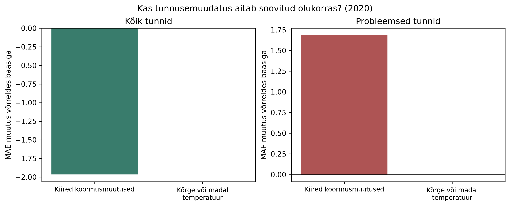
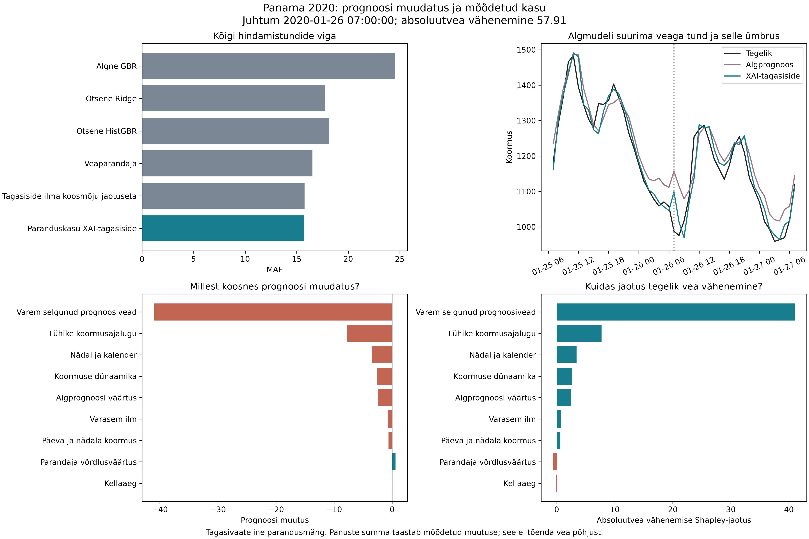
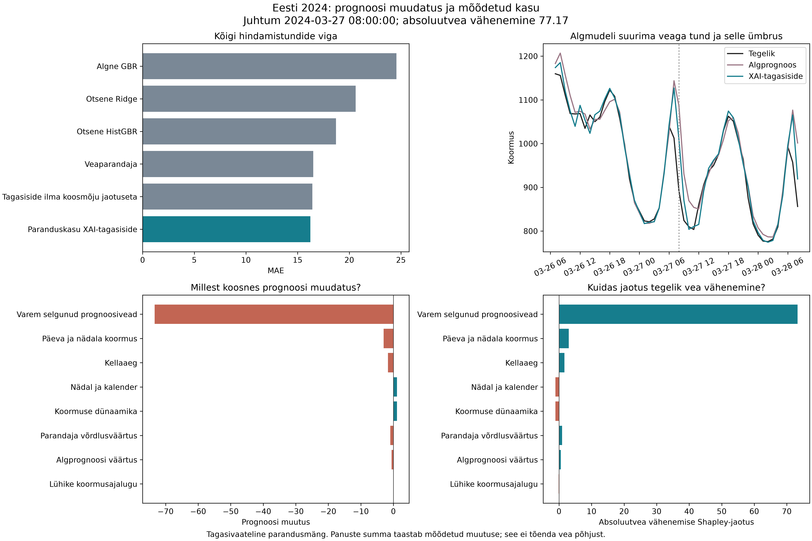

# Praktilise osa tulemused ja vastused uurimisküsimustele

Ülevaade korrastatud 03.11.2026. See fail koondab uurimisprobleemi, meetodi, olulised tulemused ja veel lahendamata küsimused. Tabelid loetakse salvestatud prognoosidest; nende uuendamiseks käivita `tools/build_report.py`. Senised arvulised tulemused säilivad aruande kõrval kolmes väikeses CSV-koondis. Detailse analüüsi jaoks arvutatakse kohalikud väljundid uuesti.

## 1. Probleem ja eesmärk

Elektrikoormuse prognoos võib olla keskmiselt täpne, kuid eksida palju just kiirete muutuste, tippude või ebatavalise ilma korral. Keskmine viga ei näita, milles probleem seisneb. SHAP näitab tunnuste panust prognoosi, kuid ei tuvasta iseseisvalt prognoosivea põhjust.

Töö eesmärk on ühendada veaanalüüs, mudeli selgitused ja varasemad sarnased juhtumid, et pakkuda kontrollitavat selgitust ning valida põhjendatud tunnusemuudatus. Keskne küsimus on, kas see aitab valida parema muudatuse kui tavaline veaanalüüs. Eesmärk ei eelda, et XAI annab parema tulemuse.

Töö tulemus on ahel **probleemse olukorra leidmine → tõendite koondamine → kontrollitav hüpotees või sellest loobumine → tunnusekatse → üldise ja probleemsete tundide vea hindamine**. Tavakasutaja tähendab siin prognoosi kasutavat analüütikut või planeerijat; arendaja ülesanne on mudelit muuta. Kaardid toetavad juhtumi kontrollimist, mitte elektrivõrgu juhtimisotsust.

## 2. Uurimisküsimused ja nende praegused vastused

Uurimisküsimused pärinevad algsest tööülesandest. Neid ei muudeta tulemuste sobitamiseks.

| Küsimus | Kuidas seda kontrollisime? | Mida tulemused lubavad öelda? | Mis jääb puudu? |
|---|---|---|---|
| **RQ1. Kuidas ühendada XAI ja veaanalüüs arusaadavateks ning kontrollitavateks diagnostilisteks selgitusteks?** | Olukorrapõhised vead, SHAP, varem teada olnud sarnased juhtumid ja kindlate reeglitega kaardid. Kontrollisime arvutusi, ajapiire ja mõlema rolli faktide kooskõla. | Kontrollitav tehniline lahendus on olemas. Kaart eristab mõõdetud fakte ja võimalikku selgitust ning võib hüpoteesi esitamata jätta. | Arusaadavust päris kasutajatele pole mõõdetud. RQ1 kasutajapoolne osa on veel vastamata. |
| **RQ2. Mil määral aitab XAI-põhine diagnostika valida tõhusamaid mudelimuudatusi kui tavapärane veaanalüüs?** | Algne sama kandidaatide ja katse-eelarvega tunnusevalik; lisaks eraldi paranduskasu XAI-tagasiside katse koos koosmõjuta ja ühe üldkaaluga kontrollidega ning fikseeritud Eesti ülekandekatse. | Algne kahe katse võrdlus ei näidanud XAI täpsuseelist. Uues katses vähendas kasujaotusel põhinev tagasiside üldist MAE-d mõlemal andmestikul; Eesti katses vähenesid ka kasvu ja languse vead võrreldes tagasisideta parandajaga. Koosmõjujaotuse lisakasu toetab üldise MAE kontrollvõrdlus, mitte kõigi olukordade ühetaoline paranemine. | Uus meetod ei tõenda algse tunnusevalikureegli ega kogu SHAP-i üldist paremust. Inimese tehtud parandusvaliku kasu on veel mõõtmata. |
| **RQ3. Kui usaldusväärsed, stabiilsed ja praktiliselt kasutatavad on loodud selgitused?** | Arvude ja SHAP-i summa kontroll, tunnusejärjestuste võrdlus eri perioodidel ja kordussobitustel, ajalooliste juhtumite ajapiirid. | Selgituste tehnilist kooskõla ja koondatud tunnusejärjestuste stabiilsust on kontrollitud. | Tehniline kontroll ei tõenda inimese arusaamist, õiget otsust ega põhjuslikku selgitust. Praktilise kasutatavuse osa vajab päris osalejatega uuringut. |

RQ2 on töö keskne katseline küsimus. Mudelite ja tunnuste laiem võrdlus annab sellele tausta; see ei ole eraldi eesmärk koguda võimalikult palju mudeleid.

## 3. Andmed ja katsekorraldus

Kasutame Panama tunnipõhist elektrikoormust: **48 048 vaatlust**, 03.01.2015 kell 01.00 kuni 27.06.2020 kell 00.00. Eesmärk on prognoosida järgmist tundi. Algfail on `data/raw/continuous dataset.csv`; andmeid ei sünteesitud ega ebatavalisi positiivseid väärtusi eemaldatud. Faili kontrollimisel puudusid lüngad ja korduvad ajatemplid.

Lisatud paranduskasu XAI-meetodi ülekandekatse kasutab eraldi Eleringi Eesti tarbimist: varasemad aastad mudelite sobitamiseks ja 2024. aasta fikseeritud meetodi hindamiseks. Selle andmekvaliteet, tunnuste vastendus, ajajoondus ja 7930 hindamistunni tulemused on 6. osa uue katseseeria juures. Alljärgneva algse katse ja laiema mudelivõrdluse jaotusi ei muudetud.

Andmestiku kirjeldus on [Mendeley andmekirjes](https://data.mendeley.com/datasets/byx7sztj59/1); seotud uuring on [Aguilar Madrid ja Antonio, 2021](https://doi.org/10.3390/info12020050). Kohalik fail ei ole uuesti allalaaditud originaaliga bititäpselt võrreldud. Koormuse MW/MWh tähendus pole piisavalt kinnitatud, mistõttu tulemused on **lähtefaili koormusühikus**. Ajatemplite puhul eeldame Panama kohalikku aega UTC−05.00; tunni alguse või lõpu tähendus pole kontrollitav.

| Periood | Algne XAI-katse | Laiem mudelite ja tunnuste võrdlus |
|---|---|---|
| 2015–2017 | Algmudeli treenimine, lävendid ja andmete kirjeldamine | Varasemad treeningperioodid |
| 2018 | Vigade diagnoos, SHAP, kaardid ja kandidaatide järjestamine | 2017. ja 2018. aasta tulemused juhivad tunnuste ja seadistuste valikut |
| 2019 | Kahe ette valitud tunnusemuudatuse võrdlus | Kõigi fikseeritud finalistide ajaline kontroll |
| 2020 olemasolev osa | Valikust eraldatud ajaline lõpphindamine, 4273 tundi | Samade finalistide hilisem võrdlus, 4273 tundi |

Jaotus põhineb prognoositava tunni ajal. Laiemas võrdluses on treenimise ja hindamise vahel 24 tundi ning kõik tunnusevariandid kasutavad sama kehtivate ridade hulka. Suurima, nelja nädala ajaloo tõttu jääb sinna 47 376 rida. Need kaks katset kasutavad erinevat tunnusevalikut; nende GBR-i tulemusi ei tohi nimetada üheks ja samaks mudeliks.

Algne projekt sisaldas kogu perioodi andmeanalüüsi. Seega on 2020 ajaline lõpphindamine, kuid seda ei saa nimetada täiesti pimedaks sõltumatuks testiks. Hiljem lisatud vastuvõtureegel ja ühe katse eelarve uurimine on selgelt **uurivad järelanalüüsid**. Käivitamisel fikseeritakse valikud enne hilisema perioodi arvutamist ning salvestatakse seadistused ja versioonide kontrollsummad. See ei ole sõltumatu eelregistreerimine. GitHubi koondid kirjeldavad juba tehtud katseid, mitte uut pimedat korduskatset.

### Tunnused ja mudelid

Tunnused kirjeldavad varasemat koormust ja selle muutusi, kellaaega ja kalendrit ning varasemat ilma. Algne baas sisaldab 13 tunnust. Laiemas võrdluses katsetati lühikest ja hooajalist koormusajalugu, eri pikkusega akende statistikat, muutusi, kalendrit, hooajalisest mustrist kõrvalekaldeid ning ilmaga seotud tunnuseid. Oli 14 nimelist tunnusekomplekti, kuid neist kaks sisaldasid samu veerge erinevas järjekorras: **13 sisuliselt erinevat komplekti**, lisaks kaheksa tunnuserühma eemaldamiskatsed. Suurimas komplektis oli 69 tunnust.

Ridge annab lihtsa lineaarse võrdluse ja piirab seotud tunnuste kordajaid. Juhumets ning ExtraTrees keskmistavad puude prognoose eri juhuslikkusega. GBR ja HistGBR lisavad puid järjest, et sobitust parandada. Igal mudeliperekonnal prooviti kaht ette määratud seadistust. Viimase teadaoleva koormuse ning eelmise päeva sama tunni prognoos on lihtsad võrdlused. Täpsed parameetrid on `configs/` failides ja iga katse salvestatud seadistuses.

Tunnuste esialgne võrdlus tehti HistGBR-iga. Seetõttu ei ole tunnusevalik mudeliperekonnast sõltumatu ja võib eelistada puumudeleid. Kolmele mudelile keskendumine varasemas esituses tehti pärast tulemuste nägemist; siin on läbipaistvuse huvides näidatud kõik viis.

### Mõõdikud ja võrdluste ebakindlus

MAE näitab keskmist absoluutviga, RMSE annab suurematele vigadele rohkem kaalu ja keskmine suunatud viga näitab üle- või alahindamist. Vea märk on alati prognoos miinus tegelik koormus. MASE jagab MAE vastava treeningperioodi 24 tunni vahede keskmise absoluutväärtusega. Selle nimetaja ei kasuta hindamisaasta andmeid. MASE alla ühe võrdleb tulemust treeningperioodi skaalaga, mitte automaatselt sama aasta lihtsa prognoosiga ([mõõdiku selgitus](https://otexts.com/fpp3/toolbox.html#scaled-errors)). Varem arvutatud MAPE ja R² säilivad katsete tabelites, kuid ei juhi valikut.

Mudelivahed arvutatakse samade tundide vigadest. Usaldusvahemiku jaoks valitakse aegreast 168-tunniseid plokke 2000 korda, juhuseemnega 42. 24-tunnine plokk on tundlikkuskontroll. Järelanalüüside mitme võrdluse vahemikud on Bonferroni parandusega; parandus ei kõrvalda pärast tulemuste nägemist tehtud valikute mõju. Statistiline erinevus ei määra vea rahalist ega praktilist tähtsust, mille hindamiseks puuduvad siin kuluandmed.

## 4. Mudelite ja tunnuste tulemused

**Tabel 1. Prognoosivead samadel hindamistundidel.** Väiksem MAE, RMSE ja MASE on parem. Suunatud viga peaks olema nulli lähedal. Kõigil viiel õppival mudelil on sama valitud koormusajaloo ja kalendri tunnusekomplekt.

<!-- results:models -->

| Aasta | Mudel | Tunde | MAE | RMSE | MASE | Suunatud viga |
| --- | --- | --- | --- | --- | --- | --- |
| 2019 | Juhuslike lõigetega mets | 8760 | 17,0877 | 30,0229 | 0,2242 | -5,5934 |
| 2019 | Histogrammi-gradientvõimendus | 8760 | 17,0151 | 28,7527 | 0,2233 | -2,5964 |
| 2019 | Juhumets | 8760 | 18,2834 | 31,1686 | 0,2399 | -5,0431 |
| 2019 | Ridge-regressioon | 8760 | 16,6421 | 30,5094 | 0,2184 | 1,2389 |
| 2019 | Gradientvõimendus (GBR) | 8760 | 20,4483 | 32,0708 | 0,2683 | -3,7370 |
| 2019 | Viimase koormuse prognoos | 8760 | 46,4593 | 60,6122 | 0,6097 | -0,0004 |
| 2019 | Eelmise päeva prognoos | 8760 | 79,5112 | 125,6951 | 1,0434 | -0,1071 |
| 2020 | Juhuslike lõigetega mets | 4273 | 22,8697 | 32,4928 | 0,2976 | 6,8434 |
| 2020 | Histogrammi-gradientvõimendus | 4273 | 17,9449 | 23,8392 | 0,2335 | 1,4141 |
| 2020 | Juhumets | 4273 | 18,2604 | 24,4877 | 0,2376 | 0,6427 |
| 2020 | Ridge-regressioon | 4273 | 17,7844 | 23,7203 | 0,2314 | 5,6998 |
| 2020 | Gradientvõimendus (GBR) | 4273 | 21,5791 | 28,6580 | 0,2808 | 2,4161 |
| 2020 | Viimase koormuse prognoos | 4273 | 38,0704 | 49,2074 | 0,4954 | 0,0166 |
| 2020 | Eelmise päeva prognoos | 4273 | 66,5558 | 102,2076 | 0,8661 | 0,4426 |

<!-- /results:models -->

Ridge oli 2019. ja 2020. aastal MAE järgi arvuliselt parim, kuid kindlat eelist HistGBR-i ees ei tõendatud. HistGBR-i 2019. aasta RMSE oli väiksem. Varasemate valikuaastate võitja ExtraTrees nõrgenes 2020. aastal. Seega ei kinnita katse universaalselt parimat algoritmi.

**Tabel 2. Ridge'i ja lähima konkurendi MAE erinevus.** Näidatud on 168 tunni plokkide ja kümne mudelipaari suhtes korrigeeritud 95% vahemikud. Negatiivne vahe tähendab väiksemat viga esimesel mudelil. Võrdlus tehti pärast tulemuste nägemist ja on uuriv.

<!-- results:pairs -->

| Aasta | Võrdlus | MAE vahe | Vahemiku alampiir | Vahemiku ülempiir |
| --- | --- | --- | --- | --- |
| 2019 | Ridge-regressioon − Histogrammi-gradientvõimendus | -0,3730 | -2,3957 | 1,6202 |
| 2020 | Ridge-regressioon − Histogrammi-gradientvõimendus | -0,1605 | -1,8037 | 1,6863 |

<!-- /results:pairs -->

**Tabel 3. Neli eri küsimusele vastavat tunnusekatset HistGBR-iga 2017.–2018. aastal.** Samad hindamistunnid ja üks fikseeritud seadistus. Eemaldamiskatse ei kuulunud kandidaatide hulka, mille seast valiti hilisem tunnusekomplekt.

<!-- results:features -->

| Tunnused | Tunnuste arv | MAE | RMSE |
| --- | --- | --- | --- |
| Algsed tunnused | 13 | 14,2640 | 22,5746 |
| Koormusajalugu ja kalender | 54 | 13,8780 | 21,7643 |
| Kõik tunnused | 69 | 13,9002 | 21,8198 |
| Eemaldatud: pikem hooajaline ajalugu | 64 | 13,7466 | 21,6631 |

<!-- /results:features -->

Lisamiskatsete seast valiti 54 tunnusega koormusajaloo ja kalendri komplekt, milles ilmatunnuseid ei olnud. Kõigi 69 tunnuse kasutamine ei andnud paremat tulemust. Ühe eemaldamiskatse madalamat viga ei kasutatud tagantjärele valitud komplekti asendamiseks. Sellest ei järeldu, et ilm oleks elektrikoormuse jaoks üldiselt kasutu.

## 5. RQ1 ja RQ3: diagnostikakaardid

### Kaartide kasutus magistritöös

Magistritöö käsitleb valitud prognoosivigade uurimist pärast tegeliku koormuse selgumist. Programmi käivitamisel koostatakse 12 juhtumi kaardid, igaühele prognoosi kasutaja ja mudeli arendaja vaade. Kahe näite puhul seome kaardil oleva info hilisemate tunnusekatsete tulemusega. Kaartide abi inimesele kontrollime väikese kasutajakatsega, mille plaan on 9. osas. Iga tunni järel töötav teenus ja mudeli iseseisev muutmine jäävad edasiseks tööks.

Juhtumid valitakse diagnoosiaasta 2018 kuni 1200 selgitusrea hulgast. Kaasame valimi esimese juhtumi ajaloo kättesaadavuse võrdluseks, väikseima absoluutveaga juhtumi ning tippkoormuse, kiire kasvu, kiire languse, kuuma, külma ja püha suurima veaga näited. Ülejäänud kohad täidetakse suurimate absoluutvigadega. Korduvat juhtumit teist korda ei lisata. Üks juhtum võib kuuluda mitmesse olukorda; esimesena rakendunud valikureegel säilib kaardil. See on näidete valik uurimiseks, mitte tõendatud parim häirereegel.

Suurt viga ei nimetata automaatselt mudeli teadaolevaks puuduseks. Väikese veaga näide ja hüpoteesita kaardid võimaldavad uurida, kas inimene oskab ka põhjendamatust muudatusest loobuda. Kaartide valikureeglid ja arv jäävad kasutajakatse ajal muutmata; valikut ei kohandata osalejate vastuste ega 2020. aasta tulemuste järgi.

### Kaardi sisu ja soovituse alus

Kaart ühendab prognoosi, tegeliku koormuse, vea, olukorra, tunnuste SHAP-panused ja varasemad sarnased juhtumid. Lävendid pärinevad treeningandmetest. Varasema juhtumi tegelik koormus peab olema päringuhetkeks teada. SHAP-i võrdlusväärtus ja kõik panused peavad kokku andma mudeli prognoosi ([TreeExplainer](https://shap.readthedocs.io/en/stable/generated/shap.TreeExplainer.html)). Seotud tunnuste tõttu ei ole panuste jaotus ühene ning tunnusepanus ei tõenda vea põhjust.

Hüpoteesi pakutakse ainult siis, kui olukorras on vähemalt 40 tundi, selle MAE ületab tavapäraste tundide oma, leidub vähemalt kolm varasemat sarnast juhtumit ning seotud tunnus kuulub kolme suurima absoluutse SHAP-panuse hulka. Need on ette määratud lihtsad reeglid, mitte tõestatud optimaalsed piirid. Kui sobib mitu reeglit, kasutatakse esimest. Reeglid seovad kiire kasvu koormusmuutuse, kiire languse jooksva keskmise ja hajuvuse ning kuuma olukorra temperatuuri ja kellaaja koosmõju katsega. Muude olukordade jaoks eraldi hüpoteesireeglit pole.

Ühest arvulisest kirjest luuakse kaks vaadet. Prognoosi kasutaja näeb juhtunu selgitust, kolme suurimat panust koos ülejäänute summaga ning põhjendatud järgmist sammu. Arendaja näeb lisaks kõiki panuseid, tunnuste väärtusi ja katseplaani. Kummaski vaates ei tohi hüpotees muutuda faktiks.

<!-- results:cards -->

Koostatud on **12 juhtumi kaks vaadet**. Kontrollitav hüpotees esitati 2 juhul; 10 juhul jäi see tõendite vähesuse tõttu esitamata. Kõik algsete kaartide arvukontrollid läbisid kontrolli. Viie olulisima tunnuse Jaccardi sarnasus oli salvestatud stabiilsusvõrdlustes 1,00–1,00 ja järjestuste Spearmani seos 0,956–1,000. Need on koondatud tunnusejärjestuste tulemused, mitte tõend iga üksikjuhtumi selgituse stabiilsuse kohta.

Kaardivaated ja piloodimaterjalid tekivad käsuga `python tools/build_card_study.py` kausta `results/card_studies/`. Osalejate tulemusi veel pole.

<!-- /results:cards -->

Kaartide juhtumid on valitud eesmärgipäraselt, mitte juhusliku valimina. Kaardid kasutavad diagnoosiaasta 2018 koondvigu ning on seetõttu juhtumite hilisem analüüs. Ainult varasemate analoogide õige ajapiir ei muuda kogu kaarti reaalajas kasutatavaks. Läbitud arvukontroll ei kinnita inimese arusaamist ega vea tegelikku põhjust.

## 6. RQ2: kas XAI aitab valida parema muudatuse?

### Algne kahe katse võrdlus

Algne XAI-katse kasutab fikseeritud GBR-i: 120 puud, õppimissamm 0,05, puu sügavus 3 ja vähemalt 30 vaatlust lehes. Mudelit ei asendata pärast laiema võrdluse tulemusi Ridge'iga, sest siis muutuks korraga nii algoritm kui ka valikumeetod.

Mõlemas juhtumiuuringus on kolm kandidaatrühma: temperatuuri teisendused, temperatuuri ja kellaaja koosmõju ning varasem ilm; kiirete muutuste puhul koormusmuutused, jooksva akna statistika ning kalender ja lühikesed koormusviivitused. Iga meetod saab valida kaks rühma kummaski juhtumiuuringus. Üks katse lisab algmudelile ühe rühma, parameetreid ei muudeta. 2019. aasta üldine MAE määrab kummastki paarist lõpliku valiku.

Eelmääratud valik kasutab konfiguratsiooni järjekorda; see ei ole päris inimese katse. Veapõhine valik järjestab kandidaate 2018. aasta suunatud vea ja kandidaattunnuste Spearmani seose järgi. XAI-põhine valik lisab sellele SHAP-i, permutatsioonitähtsuse, kaartide ja varasemate juhtumite koondskoori. Mõlemad tõendipõhised meetodid kasutavad sama kuni 1200 rea valimit. Permutatsioonitähtsus hinnati kuni 1500 real viie kordusega; see kirjeldab mudeli tundlikkust, mitte põhjuslikku mõju.

XAI järjestusskoor on `R × (1 + 0,25 × P) + 0,25 × D × C + 0,05 × V + 0,05 × H`: R on veaseos, P normaliseeritud permutatsioonitähtsus, D sobitatud juhtumite SHAP-panuste erinevus, C kandidaatide seos seotud baastunnuste panustega, V kaartide soovituste osakaal ja H varasemate juhtumite veaseos. Kaalud on heuristilised ning jäid muutmata. Täpsed väärtused on iga katse `refinements/decision_evidence.csv` tabelis. Katse hindab seda ühist valikureeglit, mitte SHAP-i üksikmõju.

Kõik kolm meetodit valisid sama lõpliku tunnuserühma kummaski juhtumiuuringus. Nende vastavate mudelite prognoosid olid identsed: **selles katses ei ilmnenud XAI täpsuseelist**.

**Tabel 4. Valitud muudatuste mõju 2020. aastal.** Olukorrad võivad kattuda. Kiire muutus ühendab kiire kasvu ja languse ning temperatuurijuhtum kuumad ja külmad tunnid. Need on tegelike hilisemate vaatlustega määratud hindamisrühmad, mitte prognoosi sisendid.

<!-- results:refinements -->

| Olukord | Probleemseid tunde | Algmudeli üldine MAE | Muudatuse üldine MAE | Algmudeli olukorra MAE | Muudatuse olukorra MAE |
| --- | --- | --- | --- | --- | --- |
| Kiired koormusmuutused | 209 | 24,8427 | 22,8779 | 37,2407 | 38,9260 |
| Kõrge või madal temperatuur | 712 | 24,8427 | 24,8423 | 24,7913 | 24,7891 |

<!-- /results:refinements -->

Koormusmuutuste tunnused vähendasid üldist MAE-d ligikaudu 7,91%, kuid kiirete muutuste tundide MAE suurenes. Temperatuuritunnuste mõju oli väga väike. Seega ei leidnud sihipärase nõrkuse parandamise hüpotees toetust pelgalt üldise vea vähenemise tõttu.

<!-- results:effect_figure -->

<!-- /results:effect_figure -->

**Joonis 1. Üldise ja probleemsete tundide MAE muutus.** Negatiivne väärtus tähendab väiksemat viga. Paneelide skaalad erinevad. Joonis näitab kirjeldavaid erinevusi, mitte vea põhjuslikku mehhanismi.

### Kahe kaardijuhtumi läbikäik

<!-- results:cases -->

Näited valitakse ainult 2018. aasta kaartide põhjal: kaartide senises järjekorras võetakse esimene vastava olukorra hüpoteesiga kaart; sellise puudumisel esimene selle olukorra kaart. Hilisem täpsusemuutus ei juhi näite valikut. 2019. ja 2020. aasta arvud kirjeldavad kogu juhtumiuuringut, mitte üksiku kaardil näidatud tunni parandamist.

#### Kiire koormusmuutus

**Juhtum.** 2018-11-12 08:00:00 (Panama kohalik aeg), card_03. Prognoos 1274,216, tegelik koormus 1380,548, viga -106,332 lähtefaili koormusühikut. Valimi suurima veaga näide olukorrast „Kiire kasv”.

**Mudeli selgitus.** Kolm suurimat absoluutset SHAP-panust: prognoositava tunni kellaaeg (tunnus 1): 74,190; viimane teadaolev koormus: 50,011; prognoositava tunni koormus eelmisel nädalal: -23,862. Varasemaid sarnaseid juhtumeid: 5. Panused kirjeldavad prognoosi kujunemist.

**Kaardi järeldus.** Varasema koormuse tunnus on SHAP-i järgi selle prognoosi kolme olulisema tunnuse hulgas. Võimalik lisainfo mudelile: viimase ühe ja kolme tunni koormusmuutused.

**Kontrollkatse.** Algsele GBR-ile lisati rühm `ramp`: load_ramp_1h, load_ramp_3h. Kaardi soovitatud tunnuserühm langes kokku hilisema XAI-põhise valikuga. See ei tõenda üksikkaardi mõju valikule.

| Aasta | Algmudeli üldine MAE | Muudatuse üldine MAE | Olukorra tunde | Algmudeli olukorra MAE | Muudatuse olukorra MAE |
| --- | --- | --- | --- | --- | --- |
| 2019 | 26,1909 | 24,8327 | 890 | 29,8899 | 39,7604 |
| 2020 | 24,8427 | 22,8779 | 209 | 37,2407 | 38,9260 |

**Mida õppisime?** Üldine viga vähenes, kuid probleemsete tundide viga suurenes. Soovitud olukorra parandamine ei leidnud toetust.

#### Kõrge või madal temperatuur

**Juhtum.** 2018-04-20 13:00:00 (Panama kohalik aeg), card_05. Prognoos 1564,893, tegelik koormus 1625,553, viga -60,659 lähtefaili koormusühikut. Valimi suurima veaga näide olukorrast „Äärmuslik kuumus”.

**Mudeli selgitus.** Kolm suurimat absoluutset SHAP-panust: viimane teadaolev koormus: 357,139; prognoositava tunni koormus eelmisel nädalal: 29,419; prognoositava tunni kellaaeg (tunnus 2): 17,930. Varasemaid sarnaseid juhtumeid: 5. Panused kirjeldavad prognoosi kujunemist.

**Kaardi järeldus.** Kaart jättis hüpoteesi pakkumata, sest reegli jaoks ei olnud piisavalt tõendeid.

**Kontrollkatse.** Algsele GBR-ile lisati rühm `temperature_nonlinear`: temperature_sq, cooling_proxy. Allpool hinnatud muudatus valiti eraldi koondskoori ja 2019. aasta võrdluse abil. Seda ei saa esitada selle kaardi soovituse tulemusena.

| Aasta | Algmudeli üldine MAE | Muudatuse üldine MAE | Olukorra tunde | Algmudeli olukorra MAE | Muudatuse olukorra MAE |
| --- | --- | --- | --- | --- | --- |
| 2019 | 26,1909 | 26,1893 | 969 | 26,0320 | 26,0378 |
| 2020 | 24,8427 | 24,8423 | 712 | 24,7913 | 24,7891 |

**Mida õppisime?** Tabel näitab kirjeldavaid erinevusi. Muudatuse kasu tuleb hinnata koos erinevuse suuruse, ebakindluse ja üldise ning olukorrapõhise veaga.

<!-- /results:cases -->

### Ühe lubatud katse järelanalüüs

Väiksema eelarve idee tekkis pärast põhikatse tulemusi. Võtsime algse 2018. aasta järjestuse esimese kandidaadi; skoorid ja kaalud jäid samaks. Kasutasime olemasolevaid prognoose ning sobitasime kaks seni puudunud lõppmudelit. See ei ole uus sõltumatu kinnitus.

**Tabel 5. XAI-põhise ja veapõhise valiku MAE vahed 2020. aastal.** Negatiivne vahe soosib XAI-valikut. Vahemikud kasutavad 168 tunni plokke ning kahe juhtumiuuringu Bonferroni parandust, eraldi üldisele ja olukorrapõhisele võrdlusele.

<!-- results:budget -->

| Juhtumiuuring | Hinnatav osa | XAI miinus veapõhise valiku MAE | Vahemiku alampiir | Vahemiku ülempiir |
| --- | --- | --- | --- | --- |
| Temperatuur | Kõik tunnid | 0,1750 | -0,0346 | 0,3734 |
| Temperatuur | Probleemsed tunnid | -0,2493 | -0,6494 | 0,1746 |
| Kiired koormusmuutused | Kõik tunnid | -1,4358 | -2,2837 | -0,6265 |
| Kiired koormusmuutused | Probleemsed tunnid | 2,5060 | 0,8663 | 4,1166 |

<!-- /results:budget -->

Kiirete muutuste puhul andis XAI-valik väiksema üldise vea, kuid probleemsetel tundidel oli veapõhine valik parem. Mõlema erinevuse korrigeeritud vahemik jäi nullist ühele poole. Temperatuurijuhtumi 168 tunni vahemikud hõlmasid nulli. 24 tunni kontrollis jäi temperatuuri üldise vea vahemik napilt nullist kõrgemale: selle juhtumi järeldus on ploki pikkuse suhtes tundlik. Kiirete muutuste erinevuste suund säilis mõlema plokipikkusega.

### Muudatuse vastuvõtureegli järelanalüüs

Teises uurivas järelkatses lubati muudatus vastu võtta ainult siis, kui 2019. aastal vähenesid nii üldine kui ka probleemsete tundide MAE ning olukorras oli vähemalt 40 tundi. Muidu säilis algmudel. Otsus valib ühe mudeli kogu järgmiseks hindamisperioodiks; tegelikke tulevikusilte ei kasutata prognooside vahetamiseks.

**Tabel 6. Vastuvõtuotsus ja hilisem olukorrapõhine tulemus.** 2020. aasta vahe on reegli tulemus miinus muudatuse tingimusteta kasutamine. Negatiivne tähendab reegli väiksemat viga. Vahemikud on kahe võrdluse suhtes korrigeeritud 95% vahemikud.

<!-- results:guard -->

| Olukord | Üldise MAE muutus 2019 | Olukorra MAE muutus 2019 | Otsus | Olukorra MAE vahe 2020 | Vahemiku alampiir | Vahemiku ülempiir |
| --- | --- | --- | --- | --- | --- | --- |
| Kiired koormusmuutused | -1,3583 | 9,8705 | Säilita algmudel | -1,6852 | -3,6623 | 0,1227 |
| Kõrge või madal temperatuur | -0,0016 | 0,0057 | Säilita algmudel | 0,0022 | 0,0000 | 0,0076 |

<!-- /results:guard -->

Mõlemad muudatused lükati 2019. aasta põhjal tagasi. Kiirete muutuste puhul andis algmudeli säilitamine 2020. aasta probleemsetel tundidel arvuliselt väiksema vea, kuid korrigeeritud vahemik hõlmas nulli. Üldine MAE suurenes samal ajal 1,9647 ühikut. Temperatuurijuhtumi erinevus oli praktilise järelduse jaoks väga väike. Reegli kasu uuel perioodil pole kinnitatud.

### Abimudel ja prognoosivea parandamine

Esimene abimudel õppis ainult tundidest, mille eel oli juba toimunud suur koormuskasv. See parandas 2020. aastal kiire kasvu MAE-d, kuid halvendas üldist MAE-d. Seetõttu võrdlesime 17 varianti kolmes olemasolevas mudeliperekonnas (GBR, Ridge ja HistGBR). Võrdluses olid algse abimudeli prognoosi osaline ühendamine, lineaarne ja mittelineaarne veaparandus, kiire kasvu näidete neljakordne kaal ning ainult kiire kasvu vigadel õppiv parandaja. Nende puhul katsetati osakaale 0,25, 0,5 ja 1. Lisaks treeniti kaks tavalist võrdlusmudelit (GBR ja HistGBR) sama laiendatud tunnuste komplektiga. Kõik variandid, ka ebaõnnestunud, säilivad ühes koondtabelis.

Veaparandaja õpib lisatavat või lahutatavat suurust, mitte kogu koormust: **uus prognoos = GBR-i prognoos + õpitud parandus**. Sisendid on algsed 13 tunnust, varem kasutatud koormusmuutused, jooksva akna keskmised ja hajuvused, viitajad ning kalendritunnused (kokku 23), lisaks GBR-i prognoos ja selle järgi oodatav tunnine muutus. Kõik on prognoosi tegemisel teada. Tegelik järgmise tunni muutus on ainult treeningu kaalumise ja hilisema hindamise alus. Valitud parandaja töötab kõigil tundidel; see ei piirdu esimese katse kasvulävendiga.

Parandaja treeninguks arvutatakse varasemate aastate prognoosivead ajaliselt: näiteks 2017. aasta prognooside mudel on treenitud ainult 2015.–2016. aasta andmetel. Arendusaastate 2018–2019 jaoks õpib parandaja 2016.–2017. aasta treeninguvälistest vigadest; 2020. aasta jaoks 2016.–2019. aasta vigadest. Nii ei õpi parandaja põhimudeli liiga optimistlikest treeningvigadest. Arendusaastate põhimudel kasutab endiselt algset 2015.–2017. aasta treeningut; lõpphindamise põhimudel kõiki andmeid enne 2020. aastat.

Valik kasutab mõlema arendusaasta üldist ja kiire kasvu MAE-d ning RMSE-d. Iga mõõdik jagatakse sama aasta ja hinnatava osa algmudeli mõõdikuga; eelistatakse varianti, mille halvim suhe on väikseim. Valikureegel ja piiratud variantide hulk pandi paika uuriva arenduse käigus ning enne selle otsingu uute 2020. aasta prognooside arvutamist. Kui ükski variant kõiki kaheksat näitajat ei paranda, säilib algmudel. 2020. aasta andmeid ega vigu valikufunktsioonile ei anta.

Kiire kasvu hindamisrühm määratakse kõigil aastatel sama, 2015.–2017. aasta tegelike tunnimuutuste 95. protsentiiliga. See hõlmab 2018. aastal 415, 2019. aastal 408 ja 2020. aastal 72 tundi. Need on ainult kasvu tunnid, mitte varasema kiire kasvu ja languse ühine rühm. Prognoosi parandamist eraldi väiksema mudeliga on uuritud ka [koormusprognoosimise varasemas töös](https://www.frontiersin.org/journals/energy-research/articles/10.3389/fenrg.2026.1966347/full); seda üldideed ei esitata meie töö uudsusena.

<!-- results:specialist -->

Algmudeliga võrreldi 17 varianti. Valituks osutus `residual_hist_1.0`: HistGBR parandab GBR-i prognoosi varasemate aastate prognoosivigade põhjal. Valik tehti 2018.–2019. aasta MAE ja RMSE järgi, arvestades eraldi kõiki tunde ja kiiret kasvu. Vähendati nende kaheksa suhte suurimat väärtust; kui ükski variant poleks kõigis parem, oleks säilinud algmudel.

| Aasta | Hinnatav osa | Tunde | Algmudeli MAE | Parandatud MAE | MAE vähenemine (%) | Algmudeli RMSE | Parandatud RMSE |
| --- | --- | --- | --- | --- | --- | --- | --- |
| 2018 | Kõik tunnid | 8760 | 17,9419 | 12,4230 | 30,7599 | 23,8631 | 16,6731 |
| 2018 | Kiire kasv | 415 | 25,6620 | 15,6376 | 39,0631 | 32,2580 | 19,5336 |
| 2019 | Kõik tunnid | 8760 | 26,1909 | 16,2674 | 37,8891 | 38,3582 | 26,8838 |
| 2019 | Kiire kasv | 408 | 33,4881 | 22,7100 | 32,1848 | 56,4097 | 50,4022 |
| 2020 | Kõik tunnid | 4273 | 24,8427 | 17,7564 | 28,5246 | 31,9119 | 23,5215 |
| 2020 | Kiire kasv | 72 | 42,3448 | 25,9335 | 38,7564 | 54,4871 | 36,0589 |

2020. aasta paarisvõrdlused (negatiivne vahe soosib parandatud mudelit):

| Võrdlusmudel | Hinnatav osa | MAE vahe | MAE vahe 95% vahemik | RMSE vahe | RMSE vahe 95% vahemik |
| --- | --- | --- | --- | --- | --- |
| Algne GBR | Kõik tunnid | -7,0863 | [-9,349; -5,359] | -8,3904 | [-11,067; -6,199] |
| Algne GBR | Kiire kasv | -16,4113 | [-25,290; -6,538] | -18,4282 | [-29,169; -6,667] |
| HistGBR samade tunnustega | Kõik tunnid | -0,4964 | [-1,609; 0,396] | -0,9402 | [-2,633; 0,344] |
| HistGBR samade tunnustega | Kiire kasv | -5,6638 | [-11,175; -1,764] | -4,0792 | [-9,958; 0,251] |

Vahemikud kasutavad 168 tunni plokke ja kaheksa võrdluse Bonferroni parandust (kaks võrdlusmudelit × kaks hinnatavat osa × kaks mõõdikut). 24 tunni plokkidega tundlikkuskontroll on paarisvõrdluste koondtabelis. Kõik ebaõnnestunud variandid on katsete koondtabelis. Arendusperioodi valik ise ei ole sõltumatu tõend paranemisest.

Esimese, täieliku asendamisega abimudeli üldine MAE oli 2020. aastal 24,885 (algmudel 24,843) ja kiire kasvu MAE 39,112 (algmudel 42,345). See variant ei parandanud mõlemat osa. Ka ainult kiire kasvu vigadel treenitud parandaja halvendas arendusaastate üldist tulemust.

2020. aasta tulemused on uurivad, sest seda perioodi ja andmestikku oli varem vaadatud. Uue otsingu varianti ei valitud 2020. aasta tulemuse põhjal, kuid vahemikud ei kõrvalda varasema andmete uurimise mõju. Katse ei tõenda SHAP-i lisakasu ega paremust kõigi varem võrreldud mudelite ees.

<!-- /results:specialist -->

**Algse GBR-iga võrreldes vähenesid 2020. aastal nii üldine kui ka kiire kasvu MAE ja RMSE. Kõik neli korrigeeritud usaldusvahemikku jäid nullist allapoole.** Sama 23 tunnusega tavalise HistGBR-i ees oli kindlam kiire kasvu MAE eelis; üldise MAE ja mõlema RMSE vahemikud hõlmasid nulli.

Paranemist hinnatakse võrreldes algse 13 tunnusega GBR-iga. Sama 23 tunnusega tavalise HistGBR-i kõrval aitab kontrollvõrdlus eristada lisatunnuste mõju ja veaparanduse võimalikku kasu. Veaparandajal on lisaks ka algprognoos ning selle järgi oodatav muutus ja treeningread erinevad, mistõttu see võrdlus ei eralda kõiki mõjusid. Laiendatud uuringu Ridge'i 2020. aasta üldine MAE oli 17,7844 ja uue lahenduse oma 17,7564; nii väike arvuline vahe ei tõenda paremust Ridge'i ees. Ridge'i paarisprognoose kohapeal pole ning selles järelkatses tema suhtes statistilist paremust ei hinnatud.

Kõik näitajad ei paranenud: 2020. aasta keskmine suunatud viga muutus −0,891-lt +1,833-le. Seega vähenesid MAE ja RMSE mõlemas hinnatavas osas, kuid absoluutne keskmine nihe suurenes. Katse ei tõenda, et iga tund, iga mõõdik või iga teine andmestik paraneks. Uus parandatud prognoos ei muuda olemasolevaid algse GBR-i SHAP-selgitusi: need selgitavad jätkuvalt algmudelit, mitte kahe mudeli summat.

### Sõltumatu kontroll enne tugevat järeldust

Praegune andmestik lõpeb 2020. aasta juunis ja selle perioodi mudelivigu on arendamisel juba vaadatud. Senine ajaliselt eraldatud hindamine on tagasivaateline. Andmete ümberjagamine, uus juhuseeme või sama katse uuesti käivitamine ei muuda neid tulemusi vaatamata testiks. Ka usaldusvahemike parandus ei kõrvalda pärast tulemuste nägemist tehtud arendusvalikute mõju.

Koodis on abimudeli arendus ja hindamine lahutatud. Arendusfunktsioonile ei anta lõpphindamise andmeid ning see keeldub kasutamast lõpphindamise perioodi või hindamistulemuste ridu. Uutel käivitustel salvestatakse valik, seadistused, kasvulävend ja hindamise reeglid manifesti enne lõpphindamise mudelite treenimist. Hindamisfunktsioon kasutab salvestatud valikut ega otsi testiosa järgi uut varianti. See parandus korrastab järgmiste käivituste järjekorda; seniste katsete varasemat salvestusjärjekorda ega tulemuste sõltumatust see tagantjärele ei muuda.

Järgmise kontrolli kord on järgmine:

1. Senised katsed jäävad arendustulemusteks. Kontrollitav lahendus on `residual_hist_1.0`; selle tunnused, osakaal ja mudeliseadistused on fikseeritud käivituse manifesti `specialist_search` osas. Praeguses andmestikus ei otsita parema tulemuse saamiseks uut testijaotust.
2. Sõltumatuks kontrolliks hangitakse sama süsteemi hilisemad andmed või eraldi andmestik, mille mudelivigu pole kasutatud selle lahenduse arendamiseks. Teine süsteem kontrollib meetodi ülekantavust, mitte Panama prognoosi tulevast täpsust. Andmeallika sobivus, ajavahemik, sisendite kättesaadavus, tunnuste vastendus ja võrdlusmudelite täpsed seadistused fikseeritakse enne selle testiosa prognoosivigade arvutamist. Testiosa ei kasutata tunnuste ega parameetrite valimiseks.
3. Treening ja võimalik seadistuste valik kasutavad ainult testile eelnevaid andmeid. Veaparandaja treeningvead arvutatakse samuti ajaliselt treeningust välja jäetud perioodidel. Korraga võetakse kasutusele algne GBR, fikseeritud veaparandus ja varem valitud tugev võrdlusmudel; võrreldakse samade tundide prognoose.
4. Enne hindamist määratakse peamisteks näitajateks üldine ja kiire kasvu MAE ning RMSE. Kiire kasvu lävend pärineb ainult treeningandmetest. Paarisvahede põhiline plokipikkus on 168 tundi, tundlikkuskontroll 24 tundi, 2000 kordust ja juhuseeme 42. Kahe võrdlusmudeli, kahe hinnatava osa ja kahe mõõdiku põhjal kasutatakse kaheksa võrdluse parandust. Väikese sündmuste arvu korral esitatakse ebakindlus ja piirang; rühma ega perioodi ei muudeta soodsama tulemuse saamiseks.
5. Fikseeritud lahenduste testitulemused vaadatakse korraga üle ja avaldatakse koos ebaõnnestumistega. Pärast seda tehtud muudatus kuulub uude arendusringi ning vajab uut hindamisperioodi. Katset ei korrata muudetud variantidega samal testiosal seni, kuni saavutatakse soovitud paranemine.

**Algse `residual_hist_1.0` variandi sõltumatu kontroll on veel tegemata.** 2020. aasta tulemust ei nimetata pimedaks kinnituseks. Alljärgnev uus paranduskasu tagasiside meetod läbis eraldi Eesti ülekandekatse, kuid selle parandaja kasutab ka veamälu ja teistsugust aastapõhist treeningut; see pole algse variandi muutmata korduskatse.

### Paranduskasu XAI-tagasiside ja sõltumatu ülekandekatse

<!-- results:attribution -->

Uus katseseeria eristab prognoosi panust ja paranduse tegelikku kasu. Esmalt katsetati ajatingimuslikku SHAP-panuste lineaarset parandust. See jäi 2018.–2019. aasta arenduses võrreldavale algtunnuste kihile alla; ebaõnnestunud variandid säilivad katsete koondis. Järgmiseks katsetati veaparandaja osade juhtimist varem selgunud paranduskasu põhjal.

**Meetod.** Ajaliselt treeningust välja jäetud GBR-i vigadel õpib HistGBR-i veaparandaja. Tema üksiktunnuste TreeSHAP-panused summeeritakse sisulisteks parandusosadeks c_j; võrdlusväärtus on eraldi osa. Nende summa taastab paranduse. See summeerimine ei ole algse mudeli kanoonilise rühma-SHAP-i uus arvutus. Rühmad on uue parandusmängu mängijad ning algseid sisendeid selles mängus ei maskeerita.

Olgu r = y − f(x) ja C = Σ c_j. Parandusmäng on v(S) = L(y,f(x)) − L(y,f(x)+Σ_(j∈S)c_j). Ruutvea korral on selle täpne Shapley-jaotus **ψ_j = c_j(2r − C)** ja Σ ψ_j = r² − (r−C)². Absoluutvea jaotus arvutatakse väikese parandusmängu kõigi koalitsioonide põhjal. Need on realiseerunud paranduskasu jaotused, mitte põhjuslikud veadiagnoosid ega muudetud prognoosi uued sisendtunnuste SHAP-väärtused. Ruutvea valem on Shapley-mängu algebraline erijuht; seda ei esitata uue üldise Shapley teoreemina.

**Tagasiside.** Varem selgunud potentsiaalse täisparanduse ψ_j keskmistatakse sama sihttunni varasemate juhtumite või jooksva ajaloo üle. Negatiivse kasuga osa osakaalu vähendatakse. Prognoosihetkel t ei kasutata y_(t+1) ega selle kasujaotust. Esimesed piisava ajaloota juhtumid kasutavad täisparandust. Võrdlused on ilma tagasisideta veaparandaja; sama andmestikuga üksikosa iseseisval kasul põhinev tagasiside; ning ühe üldise osakaaluga tagasiside, mis ei vaja osade SHAP-jaotust. Seega saab eraldi hinnata tagasiside ning osade koosmõju jaotamise lisakasu.

**Valik ja hindamine.** Perioodilise paranduskihi mõlemad esitused said sama 3 × 3 seadistuste hulga. Tagasiside iga liik sai sama kahe akna, kahe ajatingimuse ja kahe tugevuse hulga ning muutmata jätmise võimaluse. Valik kasutab ainult 2018.–2019. aasta vigu. Tagasiside valik vähendab üldise, kasvu ja languse MAE suhete keskmist ning ei luba üheski arendusaasta olukorras üle 5% halvenemist. See piir on uuriv disainivalik, mitte tõestatud optimaalne lävend. Kõik valikud salvestati enne hilisema perioodi prognooside arvutamist. Uue katseseeria GBR-i treeningread erinevad algsest RQ2-katsest, sest kõigile mudelitele kehtib nelja nädala ajaloo ühismask. Neid GBR-i tulemusi ei samastata.

**Panama, 2020: 4273 hindamistundi.**

2020. aasta oli varem uuritud: tulemus on tagasivaateline arendustõend.

| Mudel | MAE | RMSE | Kasvu MAE | Languse MAE | Halvenenud tunde (%) |
| --- | --- | --- | --- | --- | --- |
| Algne GBR | 24,5380 | 31,4924 | 42,3676 | 34,2304 | 0,0000 |
| Otsene Ridge | 17,7767 | 23,7085 | 32,1669 | 33,5387 | 37,7955 |
| Otsene HistGBR | 18,1572 | 24,4745 | 31,0752 | 27,4080 | 33,9574 |
| Veaparandaja | 16,5394 | 21,9047 | 26,7272 | 28,7848 | 32,0384 |
| Algtunnused ja veamälu | 18,3984 | 24,4953 | 31,3503 | 26,7713 | 35,7594 |
| SHAP-panused ja veamälu | 17,6947 | 23,3555 | 35,1142 | 27,9065 | 30,3300 |
| Ühe osakaaluga tagasiside | 16,5394 | 21,9047 | 26,7272 | 28,7848 | 32,0384 |
| Tagasiside ilma koosmõju jaotuseta | 15,7656 | 21,1648 | 27,0701 | 28,3363 | 30,0257 |
| Paranduskasu XAI-tagasiside | 15,7069 | 21,0800 | 27,2617 | 28,3414 | 29,4875 |

Halvenenud tundide osakaal võrdleb iga mudeli absoluutviga algse GBR-iga, mitte veaparandajaga. Väiksem MAE ei taga väiksemat halvenenud tundide osakaalu.

| Võrdlusmudel | Hinnatav osa | MAE vahe | Korrigeeritud 95% vahemik |
| --- | --- | --- | --- |
| Veaparandaja | Kõik tunnid | -0,8325 | [-1,3573; -0,3415] |
| Veaparandaja | Kiire kasv | 0,5345 | [-0,7526; 2,5939] |
| Veaparandaja | Kiire langus | -0,4434 | [-1,2930; 0,6698] |
| Otsene Ridge | Kõik tunnid | -2,0698 | [-4,1952; -0,6048] |
| Tagasiside ilma koosmõju jaotuseta | Kõik tunnid | -0,0587 | [-0,1144; -0,0057] |
| Ühe osakaaluga tagasiside | Kõik tunnid | -0,8325 | [-1,3573; -0,3415] |

Negatiivne vahe soosib XAI-tagasisidet. 24 võrdluse Bonferroni parandus, 168 tunni plokid, 5000 kordust; 24 tunni tundlikkuskontroll on koondtabelis. Valikuprotsessi varasemat andmete uurimise mõju vahemik ei kõrvalda. Eesti ja Panama ühikuid omavahel ei võrrelda. Puuduvad hindamisaknad on tegelikul tunnikalendril maskitud, nii et plokk tähendab tunde, mitte puuduliku tabeli järjestikuseid ridu.

**Algmudeli suurima absoluutveaga juhtum.** Näite valikureegel on kirjeldav ega tõenda tüüpilist kasu.

**Juhtum 2020-01-26 07:00:00.** Tegelik koormus 987,821; algprognoos 1156,933; parandatud prognoos 1099,021.

Absoluutviga 169,112 → 111,201; vea vähenemine 57,912. Kõik arvud on vastava andmestiku koormusühikus.

| Paranduse osa | Panus prognoosi muutusse | Vea vähenemise Shapley-jaotus |
|---|---:|---:|
| Varem selgunud prognoosivead | -40,990 | 40,990 |
| Lühike koormusajalugu | -7,729 | 7,729 |
| Nädal ja kalender | -3,423 | 3,423 |
| Koormuse dünaamika | -2,575 | 2,575 |
| Algprognoosi väärtus | -2,484 | 2,484 |
| Varasem ilm | -0,725 | 0,725 |
| Päeva ja nädala koormus | -0,624 | 0,624 |
| Parandaja võrdlusväärtus | 0,587 | -0,587 |
| Kellaaeg | 0,050 | -0,050 |

Esimese arvveeru positiivne väärtus suurendab prognoosi. Teise positiivne väärtus tähendab sellele osale jaotatud absoluutvea vähenemist; negatiivne väärtus tähendab jaotatud kahju. Üksiku osa eemaldamise mõju võib erineda.
Tagasivaateline jaotus arvestab paranduste koosmõju. See ei tõenda algse vea põhjust ega sama paranduse tulevast kasu.

**Paranduse suurima kahjuga juhtum.** Näite valikureegel on kirjeldav ega tõenda tüüpilist kasu.

**Juhtum 2020-01-24 15:00:00.** Tegelik koormus 1590,618; algprognoos 1583,284; parandatud prognoos 1664,836.

Absoluutviga 7,333 → 74,218; vea vähenemine -66,885. Kõik arvud on vastava andmestiku koormusühikus.

| Paranduse osa | Panus prognoosi muutusse | Vea vähenemise Shapley-jaotus |
|---|---:|---:|
| Varem selgunud prognoosivead | 57,304 | -51,496 |
| Lühike koormusajalugu | 19,450 | -13,642 |
| Algprognoosi väärtus | 7,335 | -2,596 |
| Päeva ja nädala koormus | -2,388 | 0,869 |
| Parandaja võrdlusväärtus | 1,923 | -0,764 |
| Koormuse dünaamika | -1,722 | 0,633 |
| Varasem ilm | -0,933 | 0,343 |
| Nädal ja kalender | 0,511 | -0,202 |
| Kellaaeg | 0,073 | -0,029 |

Esimese arvveeru positiivne väärtus suurendab prognoosi. Teise positiivne väärtus tähendab sellele osale jaotatud absoluutvea vähenemist; negatiivne väärtus tähendab jaotatud kahju. Üksiku osa eemaldamise mõju võib erineda.
Tagasivaateline jaotus arvestab paranduste koosmõju. See ei tõenda algse vea põhjust ega sama paranduse tulevast kasu.

**Eesti, 2024: 7930 hindamistundi.**

Eraldi ülekandekatse kasutab Eleringi tegelikku tarbimist. Panama paranduskihi ja tagasiside seadistusi Eestis ümber ei valitud. Mudelid sobitati kohalikel varasematel andmetel, algoritmi valikureegel jäi fikseerituks. Ilm ning püha/kooli märgendid puuduvad ja jäeti kõigil vastavatel mudelitel välja. Tunni koormus tähistab lõppenud intervalli keskmist; jaotused on UTC järgi, kalender Europe/Tallinn järgi. Allalaaditud 2025. aasta osa jäeti enne prognoosivigade arvutamist kõrvale selle puudulikkuse tõttu, mitte mudeli tulemuse põhjal. Kasutatud 2018.–2024. aasta osas oli 12 puuduvat või sobimatut tunniväärtust; neist 3 olid nullkoormused, mida käsitleti riikliku koormuse puuduva mõõtmisena. Väärtusi ei interpoleeritud. Puuduliku ajaloo või sihiga aknad jäeti välja. Uuring eeldab viimase lõppenud tunni koormuse ja vea kohest saadavust; tegelikke avaldamisviivitusi selle allika põhjal ei kinnitatud.

| Mudel | MAE | RMSE | Kasvu MAE | Languse MAE | Halvenenud tunde (%) |
| --- | --- | --- | --- | --- | --- |
| Algne GBR | 24,5635 | 33,8555 | 41,3299 | 54,7974 | 0,0000 |
| Otsene Ridge | 20,6167 | 27,6405 | 41,9937 | 34,9335 | 45,4351 |
| Otsene HistGBR | 18,7086 | 26,3914 | 30,8603 | 42,9839 | 35,0441 |
| Veaparandaja | 16,5063 | 23,9811 | 25,0380 | 39,4438 | 31,5637 |
| Algtunnused ja veamälu | 16,6399 | 24,2106 | 24,7705 | 38,7414 | 32,6482 |
| SHAP-panused ja veamälu | 16,9855 | 24,3836 | 23,6115 | 37,7053 | 31,8033 |
| Ühe osakaaluga tagasiside | 16,5063 | 23,9811 | 25,0380 | 39,4438 | 31,5637 |
| Tagasiside ilma koosmõju jaotuseta | 16,4310 | 23,4569 | 23,8394 | 36,1433 | 34,0479 |
| Paranduskasu XAI-tagasiside | 16,2398 | 23,3637 | 23,9031 | 36,3197 | 33,0013 |

Halvenenud tundide osakaal võrdleb iga mudeli absoluutviga algse GBR-iga, mitte veaparandajaga. Väiksem MAE ei taga väiksemat halvenenud tundide osakaalu.

| Võrdlusmudel | Hinnatav osa | MAE vahe | Korrigeeritud 95% vahemik |
| --- | --- | --- | --- |
| Veaparandaja | Kõik tunnid | -0,2665 | [-0,5072; -0,0271] |
| Veaparandaja | Kiire kasv | -1,1348 | [-1,9376; -0,4267] |
| Veaparandaja | Kiire langus | -3,1242 | [-4,4142; -1,8371] |
| Otsene Ridge | Kõik tunnid | -4,3769 | [-5,0559; -3,7035] |
| Tagasiside ilma koosmõju jaotuseta | Kõik tunnid | -0,1912 | [-0,2683; -0,1114] |
| Ühe osakaaluga tagasiside | Kõik tunnid | -0,2665 | [-0,5072; -0,0271] |

Negatiivne vahe soosib XAI-tagasisidet. 24 võrdluse Bonferroni parandus, 168 tunni plokid, 5000 kordust; 24 tunni tundlikkuskontroll on koondtabelis. Valikuprotsessi varasemat andmete uurimise mõju vahemik ei kõrvalda. Eesti ja Panama ühikuid omavahel ei võrrelda. Puuduvad hindamisaknad on tegelikul tunnikalendril maskitud, nii et plokk tähendab tunde, mitte puuduliku tabeli järjestikuseid ridu.

**Algmudeli suurima absoluutveaga juhtum.** Näite valikureegel on kirjeldav ega tõenda tüüpilist kasu.

**Juhtum 2024-03-27 08:00:00.** Tegelik koormus 891,900; algprognoos 1086,046; parandatud prognoos 1008,878.

Absoluutviga 194,146 → 116,978; vea vähenemine 77,168. Kõik arvud on vastava andmestiku koormusühikus.

| Paranduse osa | Panus prognoosi muutusse | Vea vähenemise Shapley-jaotus |
|---|---:|---:|
| Varem selgunud prognoosivead | -73,336 | 73,336 |
| Päeva ja nädala koormus | -2,979 | 2,979 |
| Kellaaeg | -1,673 | 1,673 |
| Nädal ja kalender | 1,123 | -1,123 |
| Koormuse dünaamika | 1,119 | -1,119 |
| Parandaja võrdlusväärtus | -0,956 | 0,956 |
| Algprognoosi väärtus | -0,545 | 0,545 |
| Lühike koormusajalugu | 0,078 | -0,078 |

Esimese arvveeru positiivne väärtus suurendab prognoosi. Teise positiivne väärtus tähendab sellele osale jaotatud absoluutvea vähenemist; negatiivne väärtus tähendab jaotatud kahju. Üksiku osa eemaldamise mõju võib erineda.
Tagasivaateline jaotus arvestab paranduste koosmõju. See ei tõenda algse vea põhjust ega sama paranduse tulevast kasu.

**Paranduse suurima kahjuga juhtum.** Näite valikureegel on kirjeldav ega tõenda tüüpilist kasu.

**Juhtum 2024-09-29 07:00:00.** Tegelik koormus 835,200; algprognoos 858,300; parandatud prognoos 932,748.

Absoluutviga 23,100 → 97,548; vea vähenemine -74,448. Kõik arvud on vastava andmestiku koormusühikus.

| Paranduse osa | Panus prognoosi muutusse | Vea vähenemise Shapley-jaotus |
|---|---:|---:|
| Varem selgunud prognoosivead | 66,973 | -66,973 |
| Algprognoosi väärtus | 5,413 | -5,413 |
| Päeva ja nädala koormus | 4,594 | -4,594 |
| Koormuse dünaamika | -2,463 | 2,463 |
| Nädal ja kalender | -1,905 | 1,905 |
| Kellaaeg | 1,575 | -1,575 |
| Lühike koormusajalugu | 1,216 | -1,216 |
| Parandaja võrdlusväärtus | -0,956 | 0,956 |

Esimese arvveeru positiivne väärtus suurendab prognoosi. Teise positiivne väärtus tähendab sellele osale jaotatud absoluutvea vähenemist; negatiivne väärtus tähendab jaotatud kahju. Üksiku osa eemaldamise mõju võib erineda.
Tagasivaateline jaotus arvestab paranduste koosmõju. See ei tõenda algse vea põhjust ega sama paranduse tulevast kasu.

**Uudsuse piir.** Prognoosi-SHAP, veafunktsiooni Shapley-jaotus, Shapley-regressioon ning SHAP-iga juhitud mudelikaalud on varasemas kirjanduses olemas. Käesoleva töö uuritav kombinatsioon on varem realiseerunud paranduskasu täpse osajaotuse kasutamine elektrikoormuse paranduse ajatingimuslikus tagasisides ning sama jaotuse näitamine koos prognoosi muudatusega. Täpset sama kombinatsiooni sihitud otsingus ei leitud; esmakordsus pole tõendatud. Otsingu päringud ja lähimate tööde erinevused on [uurimismärkmes](research_directions.md). Mõõdetud täpsus ei tõenda kaartide arusaadavust ega kasu päris kasutajale.

<!-- /results:attribution -->

## 7. Võimalik teaduslik panus ja selle piir

Töö võimalik panus on kontrollitava diagnoosi, sama katse-eelarvega valikuvõrdluse ning üldise ja probleemsete tundide tulemuse ühine hindamine. Sama juhtumi kaks vaadet säilitavad samad arvud ja järelduse tugevuse. Tulemused näitavad ka esialgse tunnusemuudatuse ebaõnnestumist soovitud olukorras. Uuriv veaparandus vähendas hiljem algse GBR-i üldist ja kiire kasvu viga, kuid paremust kõigi võrreldud mudelite ees pole kinnitatud.

Uus konkreetne XAI-panuse kandidaat on **paranduse realiseerunud kasu osajaotuse kasutamine järgmiste paranduste ajatingimuslikus juhtimises**, koos prognoosimuutuse ja veavähenemise eraldi kuvamisega. Samade paranduste koosmõju arvestava ja koosmõjuta variandi võrdlus eristab selle osa lisakasu. Meetodit hinnati Panama arenduses ning fikseeritud seadistustega Eesti 2024. aasta andmetel. Lähimate tööde ja erinevuste [uudsusotsing](research_directions.md) toetab selle kombinatsiooni edasi põhjendamist, kuid ei kinnita esmakordsust. Üldise ja olukorrapõhise tulemuse piirid säilivad: Panama kiire kasvu viga suurenes veidi võrreldes tagasisideta parandajaga ning Eestis ei olnud koosmõju arvestav variant kasvu ja languse MAE järgi koosmõjuta variandist parem.

SHAP-i, Panama andmete või kasutajarollide kasutamine pole eraldi uudne:

| Lähim varasem töö | Mida see tähendab meie panuse jaoks? |
|---|---|
| [Robin jt, 2024](https://cris.technion.ac.il/en/publications/evaluating-model-performance-through-a-user-centric-explainable-f/) — Panama koormus, GBR, PFI, SHAP ja eri kasutajate vajadused | Väga lähedane lähtekoht. Loetud on bibliokirje ja abstrakt; enne esmakordsusväidet on vaja täisteksti võrdlust. |
| [Park, Lee ja Kim, 2026](https://doi.org/10.32604/cmc.2026.079734) — SHAP-iga suunatud tunnused kuises koormusprognoosis | SHAP-i sidumine mudeli parandamisega on olemas. Meie küsimus on lisakasu veapõhise valiku ees ja mõju soovitud olukorras. |
| [LIMREF, 2022](https://ojs.aaai.org/index.php/AAAI/article/view/21469) ja [Sokol ning Flach, 2020](https://arxiv.org/abs/2001.09734) | Reeglipõhised koormusprognoosi selgitused ja kasutajale kohandamine pole uued üldideed. |
| [Oakden-Rayner jt, 2020](https://arxiv.org/abs/1909.12475) — varjatud alarühmade nõrkused meditsiinilises ML-is | Põhjendab teise valdkonna hindamispõhimõtte rakendamist: hea keskmine võib varjata oluliste olukordade halvenemist. |

Allikaotsing oli sihitud, mitte ammendav süstemaatiline ülevaade. Samalaadse kombinatsiooni esmakordsust ei ole tõendatud. Molika Measi 2022. aasta näidistööd kasutati praktilise osa ülesehituse eeskujuna; selle tulemused ei ole meie uuringu tõendid.

### Võrdlus Molika tööga: teaduslik tugevus ja puudujäägid

Võrdlus tehtud 22.10.2026 kasutaja antud Molika Measi töö täisteksti põhjal: [XAI-Based Fault Detection, Diagnosis and Monitoring Method for Air Handling Units, 2022](https://digikogu.taltech.ee/en/Download/3d2f7489-e1a7-4752-b065-e1d93986cded). Leheküljeviited tähistavad töö enda lehekülgi, mitte PDF-i järjekorranumbreid. Klassifitseerimise F1-skoori ja meie koormusprognoosi MAE-d ei saa omavahel paremuse tõendina võrrelda.

| Teema | Molika töö | Meie projekt ja hinnang |
|---|---|---|
| Valdkonna tundmine | Ühe ventilatsiooniseadme tegelikud mõõtmised, eksperdi märgendatud rikked ning kolm füüsikaliselt põhjendatud lisatunnust (lk 31–38). | Koormusajaloo, kalendri ja ilma tunnused on läbi katsetatud, kuid diagnoosireeglid ja kasutajarollide vajadused pole valdkonnaekspertidega kinnitatud. |
| Mudelite kontroll | Logistiline regressioon, juhumets ja XGBoost; rikete kaupa mõõdikud (lk 39–42). | Viis mudelit, lihtsad võrdlused, ajaline jaotus ja paarisvahede usaldusvahemikud. Arvuline võrdlus on põhjalik, kuid mudelite arv ei tõenda uudsust. |
| Selgituste ühendamine | SHAP, valdkonnateadmisel põhinev tunnuste valik ja juhtumi lühike ajalugu (lk 28–30, 46–52). | SHAP, PFI, veakontekst, varasemad sarnased juhtumid, hüpoteesireeglid ja kaks rollivaadet. Põhjendatud kombinatsioon on olemas, iga lisandi kasu pole eraldi mõõdetud. |
| Kasutajakesksus | Seitse inseneri andsid nõuded ning hindasid hiljem kolme esitusviisi kahe rikke näitel (lk 46–55). | Arvukontroll ja piloodimaterjalid on valmis. Kasutajate tegelik vajadus, arusaamine ja järgmise sammu valimise kasu on veel mõõtmata. |
| Selgitusest mudelimuudatuseni | Põhirõhk on diagnoosi selgitamisel ja selle esitusel. | Võrdleme sama katse-eelarvega muudatuse valimist ning kontrollime, kas paraneb just soovitud olukord. See on meie töö eristuv uurimisülesanne Molika töö suhtes. |
| Üldistamise piir | Üks seade, juhuslik kihistatud 66/34 jaotus, väike kasutajavalim; autor kirjeldab neid piiranguid (lk 36, 56–58). | Algne katse kasutab Panama varem vaadatud perioodi. Uuel paranduskasu meetodil on eraldi Eesti ülekandekatse; see laiendab tõendit kahe süsteemini, kuid ei tõenda üldist kasutatavust ega paremust kõigis olukordades. |

Molika tugevus on eelkõige seos kasutaja tegeliku tööga. Meie kahe rolli olemasolu ei asenda kasutajate kaasamist. Ka Molika tulemusi tuleb piirata: nõuete andjad hindasid hiljem ka esitusi, kirjeldatud uuringus näidati neid järjekorras (a), (b), (c), ning lisas kasutati sama rikketüübi eri ajatemplitega näiteid. See piirab puhtalt esitusviisi mõju eristamist. Tema uuring ei ole suur juhuslikustatud tõend otsuste objektiivse täpsuse paranemisest. Meie kavandatud faktide kooskõla, tasakaalustatud järjekorrad ja ülesannete hindamine aitavad neid piiranguid arvestada, kuid selle plaani kasu pole veel mõõdetud.

Meie ühendatud meetodi hindamisel jäävad lisaks silma neli konkreetset piirangut:

1. **Kandidaatide valiku eristusvõime on väike.** Algses katses võetakse kummaski juhtumis kolmest kandidaadist kaks; kõik meetodid valisid sama paari. See on selle protseduuri nulltulemus. Sellest ei saa järeldada, et XAI oleks üldiselt kasulik või kasutu.
2. **Kaartide eraldiseisev mõju pole näidatud.** Tabelis `refinements/decision_evidence.csv` on temperatuurijuhtumi kaartide soovituskomponent kõigil kandidaatidel null. Kiirete muutuste kahel tugevamal kandidaadil on see sama, 1/12. See komponent ei erista nende omavahelist järjestust. Kaarditeksti kasu inimesele on omakorda veel uurimata. Ka hüpoteesist loobumise asjakohasust pole sõltumatu eksperdihinnangu abil kontrollitud; reegli täitmine ei ole selleks piisav tõend.
3. **Tunnuste eemaldamine ei ole selgituskomponentide eemaldamise katse.** Tunnusekatsed ei erista SHAP-i, PFI, varasemate juhtumite ja kaartide panust koondskoori. Ka skoorikaalude valikut ei ole sõltumatult kinnitatud. Täielikule paketile saadud tulemust ei saa omistada ühele selle osale.
4. **Võrdne treenimiskatsete arv ei tähenda võrdset kogukulu.** XAI vajab lisaarvutusi ja tõlgendamist; nende aega või inimese töömahtu ei ole praktilise kasu võrdluses tervikuna mõõdetud. Põhjendatud kasuväide peaks arvestama ka seda kulu.

Komponente on piisavalt. Teaduslikku taset tõstab nüüd nende vajalikkuse kontroll, mitte uute lisamine. Väikseima lisamahuga on kolm sammu: küsida piloodis enne ülesandeid ka tegeliku töö ja infovajaduse kohta; hinnata päris vastustest arusaamist ja järgmise sammu põhjendatust; kontrollida olemasolevate skooride põhjal uurivalt, kas ühe komponendi väljajätmine muudab kandidaadi valikut. Viimane ei nõua tingimata uute mudelite treenimist, kuid ei asenda uut hindamisperioodi ega tõenda üksinda komponendi kasu.

Töö ühendab algse diagnoosi ja muudatuse valiku nulltulemuse uue, kontrollitava paranduskasu XAI-tagasiside meetodiga. Selle üldise MAE lisakasu ning osa olukorrapõhiseid parandusi toetavad paarisvõrdlused ja Eesti ülekandekatse. XAI üldist paremust, kaartide tõendatud kasutatavust ega kombinatsiooni esmakordsust ei ole näidatud. Katsete arv ise neid puuduvaid tõendeid ei asenda.

## 8. Mis jääb tervikliku uuringu jaoks puudu?

| Puudujääk | Miks see järeldust piirab? | Vajalik järgmine samm |
|---|---|---|
| **Päris kasutajate hinnang puudub.** | RQ1 arusaadavus ja RQ3 praktiline kasutatavus on vastamata. | Viia läbi allpool kirjeldatud väike piloot, koguda vastused ning kirjeldada ka arusaamatusi ja ebaõnnestumisi. |
| **Järelanalüüsid kasutavad juba nähtud perioodi.** | Eelarve ja vastuvõtureegli võimalik kasu ei ole sõltumatult kinnitatud. | Säilitada need uurivate tulemustena. Kinnitava väite jaoks fikseerida sama reegel enne uue, puutumata perioodi hindamist. |
| **Lähima varasema töö täisteksti võrdlus on tegemata.** | Võimalikku panust ei saa nimetada esmakordseks. | Võrrelda Robin jt töö eesmärki, diagnoosi, katse-eelarvet ja hindamist meie lahendusega; täpsustada panuse sõnastust. |
| **Andmete tegelikud avaldamisajad pole teada.** | Koormuse kohene saadavus ja 24 tundi varasem ilm ei kinnita töövõimet päris kasutuses. | Piirduda meetodiuuringu järeldusega. Operatiivse väite jaoks on vaja avaldamisaegadega koormusandmeid ja arhiveeritud ilmaprognoose. |
| **Kontrollitud on kaks süsteemi ja piiratud meetodivalik.** | Eesti ülekandekatse toetab uue paranduskasu tagasiside meetodit, kuid mitte kõigi XAI-komponentide ega kõigi prognoosimudelite paremust. | Piirata järeldus mõõdetud meetodi, andmete ja olukordadega; koguda ka päris kasutajate tõendid. |

Ilm on [MERRA-2 reanalüüs](https://gmao.gsfc.nasa.gov/gmao-products/merra-2/faq_merra-2/), mitte arhiveeritud ilmaprognoos. 24-tunnine nihe aitab vältida järgmise tunni tegeliku ilma kasutamist, kuid ei kinnita avaldamisaega. QV2M on eriniiskus, mitte suhteline õhuniiskus protsentides; TQL ei ole mõõdetud sademete hulk. Kaardid ei anna prognoosi usaldusvahemikku ega hüpoteesi tõenäosust.

**Praegune seis:** arvutuslik teostus ja RQ2 võrdlus on olemas. Kasutajakesksuse empiiriline hindamine on lõpetamata. Järgmine vajalik töö on vastuste kogumine ja järelduste täpsustamine, mitte katsete hulga kasvatamine.

## 9. Kasutajauuringu järgmine samm

See on **plaan, mitte tehtud uuring**. Väikese piloodi kavandatav maht on kaheksa osalejat: neli prognoosi kasutajat ja neli mudeli arendajat. Arv on praktiline esialgse piloodi siht, mitte statistilise võimsuse arvutus. Kui värbamine erineb plaanist, dokumenteeritakse tegelik valim ja põhjused enne tulemuste tõlgendamist.

Kummaski rollis võrreldakse struktureeritud kaarti sama rolli täpselt samade faktide loendiga. Nii hinnatakse esituse abi, mitte rollile kohandamise eraldiseisvat mõju. Neli eesmärgipäraselt valitud juhtumit sisaldavad kaht hüpoteesiga ja kaht hüpoteesita kaarti. Iga osaleja näeb iga juhtumit ühe korra: kaks kaardina, kaks loendina. Olemas on kaheksa tasakaalustatud järjestuse varianti; järjekorrad määratakse enne ülesandeid rollirühma sees juhuslikult ja võimalikult tasakaalustatult.

Enne ülesandeid küsime osaleja tavapäraste ülesannete ja prognoosivigade uurimiseks vajaliku info kohta. Anname kõigile sama lühikese sissejuhatuse prognoosi, vea ja tunnusepanuse tähendusse. Uuringujuhtumite vastuseid ei harjutata. Kogutud vajadused aitavad hiljem selgitada, kelle töös kaartidest abi võiks olla; neid ei esitata juba tehtud kasutajanõuete uuringuna.

Iga juhtumi puhul palutakse kirjeldada vea suunda ja suurust, eristada prognoosihetkel teada olnud infot hilisemast vaatlusest, hinnata põhjusväite lubatavust ning põhjendada rollile sobivat järgmist sammu. Neli mõõdet annavad igaüks 0–2 punkti, kokku 0–8. Kaks hindajat hindavad vastuseid iseseisvalt, esitusviisi teadmata. Põhjendatud mittenõustumine kaardi soovitusega võib saada täispunktid. Enne hindamist täpsustatakse juhend näidisvastustega ning hilisemad muudatused dokumenteeritakse.

Aeg, teksti selgus, otsuse kindlus ja veatüübid on teisesed näitajad. Tulemused esitatakse osalejate tasemel ja rollirühmade kaupa; nelja vastust ühelt inimeselt ei loeta neljaks sõltumatuks osalejaks. Väike piloot kirjeldab materjalide arusaadavust ega tõenda üldist kasutatavuse paranemist. Mõlema esituse kehv tulemus on samuti tulemus, mida tuleb näidata.

Piloot hindab juhtumist arusaamist ja järgmise sammu põhjendatust. Kaardi soovituse kordamine üksi ei anna täispunkte. Inimese valitud muudatuse tegelikku mõju prognoositäpsusele selles piloodis ei mõõdeta: selleks tuleks valikud eraldi sama katsete arvuga läbi proovida ja hilisematel andmetel hinnata. See lisakatse ei kuulu praegu kokkulepitud töömahtu. RQ2 mudelimuudatuste arvuline võrdlus on sellest kasutajakatsest eraldi.

Enne värbamist kontrollitakse asutuse uuringukorda, kogutakse teadlik nõusolek ja lepitakse kokku andmete säilitamise aeg. Osalemine on vabatahtlik ning vastustes kasutatakse osalejatunnuseid. Valmis vastusemallid kopeeritakse päris andmete kogumiseks eraldi uuringukausta; algseid katsematerjale ei kirjutata üle. Osalejate vastuseid ei asendata sünteetiliste ega keelemudeli loodud vastustega.

## 10. Tulemuste täpsed lähtefailid

Aruande kõrval on mudelimõõdikud, kõigi kandidaatide koondtulemused ja paarisvõrdlused. Ka halvemad katsetulemused jäävad nähtavaks. Tunniprognoosid ja muud mahukad väljundid ei kuulu GitHubi projekti; need arvutatakse vajaduse korral uuesti. Käivituskäsud on README-s.

<!-- results:sources -->

- [Mudelite mõõdikud](metrics.csv).
- [Kõigi tunnuse-, mudeli- ja muutmiskatsete koondtulemused](trials.csv).
- [Paarisvõrdlused ja nende usaldusvahemikud](comparisons.csv).

Tunnipõhised kohalikud väljundid tekivad uuringu käivitamisel `results/` alla. Neid, treenitud mudeleid ega lähtekoodi varukoopiaid GitHubi ei lisata. Kordamiseks on vaja algandmeid, seda lähtekoodi ja `configs/` seadistusi.

Tunnusetabeleid ja ajalisi andmejaotusi eraldi failidesse ei salvestata: need koostatakse vajaduse korral algandmetest ning katse seadistustest uuesti mälus. Tunnuse- ja mudelivalikust säilivad mõõdikud; lõppvõrdlustest säilivad kontrolliks ja usaldusvahemike arvutamiseks vajalikud prognoosid. Eelarvekatse kasutab olemasolevaid prognoose neid kopeerimata. See muudab failide salvestamist, mitte katsemeetodit ega siin esitatud teadustulemusi.

<!-- /results:sources -->
